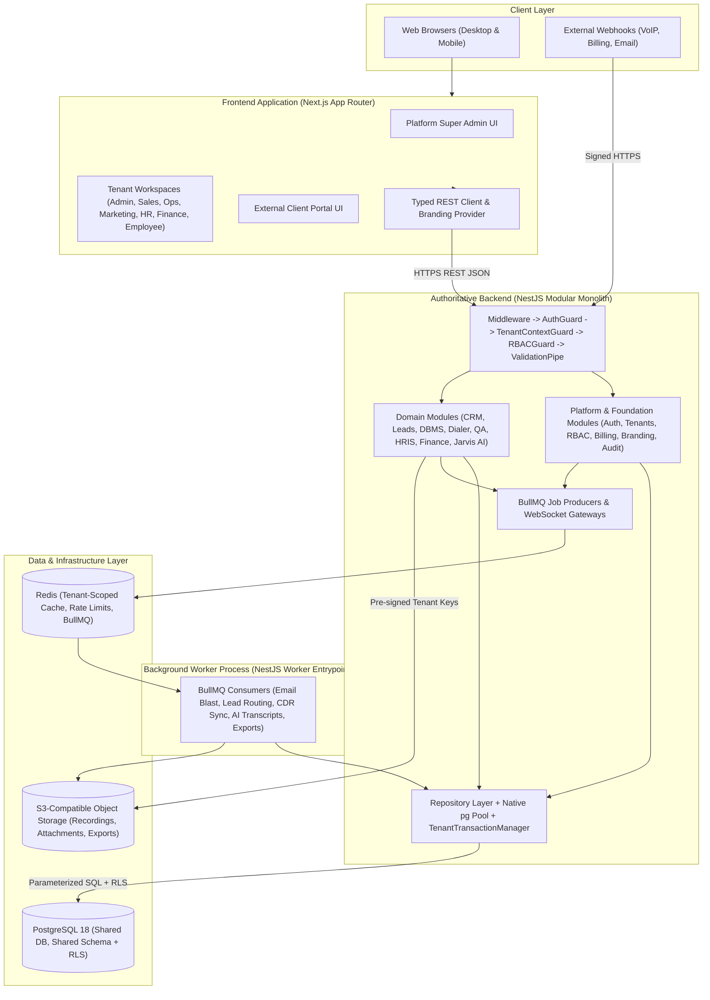

# System Architecture

**Last Updated:** 2026-11-12  
**Status:** Phase 0 Architecture Specification  
**Version:** 0.1.0

---

## 1. Architectural Style: Modular Monolith

The platform uses a **Modular Monolith** architecture with strict physical separation between the web client, API server, background worker runtime, relational database, cache/queue broker, and object storage.



---

## 2. Repository & Directory Structure (Planned for Phase 1)

```text
/
├── apps/
│   ├── web/                        # Next.js (React, TypeScript, Tailwind CSS)
│   │   ├── src/
│   │   │   ├── app/                # Route groups: (auth), (super-admin), (workspace), (portal)
│   │   │   ├── components/         # Design system & reusable enterprise UI primitives
│   │   │   ├── features/           # Domain-aligned frontend feature modules
│   │   │   ├── lib/api/            # Centralized typed API client (no business logic)
│   │   │   ├── providers/          # Auth, ActiveTenant, BrandingTheme, Query providers
│   │   │   └── hooks/              # Permission & UI state hooks
│   │   └── tests/e2e/              # Playwright end-to-end tests
│   └── api/                        # NestJS authoritative backend
│       ├── src/
│       │   ├── main.ts             # HTTP API entrypoint + Swagger setup
│       │   ├── worker.ts           # BullMQ background processor entrypoint
│       │   ├── common/             # Guards, Interceptors, Decorators, Filters, Pipes
│       │   ├── database/           # pg Pool, TenantTransactionManager, Migration runner
│       │   ├── cache/              # Tenant-prefixed Redis service
│       │   ├── storage/            # Tenant-prefixed S3 service
│       │   └── modules/            # Isolated domain modules (auth, tenants, rbac, crm, etc.)
│       └── test/                   # Jest unit & Supertest integration/security suites
├── packages/
│   └── shared-types/               # Pure TypeScript DTO interfaces, enums, permission constants
├── db/
│   ├── migrations/                 # Version-controlled sequential SQL migration files
│   ├── seeds/                      # Idempotent bootstrap seeds (permissions catalog, default branding)
│   └── scripts/                    # Role setup, backup verification, RLS verification scripts
├── docker/                         # Dockerfiles & local/staging compose definitions
├── .github/workflows/              # GitHub Actions CI/CD pipelines
└── docs/                           # Permanent architecture, DB, module, QA, and ops documentation
```

---

## 3. Layer Responsibilities & Strict Boundaries

### 3.1 Frontend (`apps/web` – Next.js)
- **Presentation & UX Only:** Renders 9 distinct persona areas (`Platform Super Admin`, `Tenant Admin`, `Employee`, `Operations`, `Sales`, `Marketing`, `HR`, `Finance`, and `Client Portal`) via role-aware layouts.
- **No Backend Shadowing:** Next.js Route Handlers must **never** connect to PostgreSQL, Redis, or S3, and must **never** duplicate business logic or authorization checks. Only minimal BFF cookie-forwarding or health probes are allowed if needed.
- **UI Permission Gating vs Security:** Hiding navigation items in React improves UX, **not** security. Every API call is independently authorized by NestJS.
- **Standard UX States:** Every data view implements standardized `LoadingSkeleton`, `ErrorState` (with correlation ID), and `EmptyState` components.

### 3.2 Backend (`apps/api` – NestJS)
Every NestJS module strictly separates internal layers:
1. **Controller:** HTTP routing, OpenAPI decorators, status codes, DTO binding. Zero SQL or business rules.
2. **Service:** Domain workflows, cross-module orchestration via exported service interfaces, audit emission, and queue dispatching.
3. **Repository:** Exclusive owner of parameterized SQL queries via `DatabaseService`. Returns typed domain rows; never leaks `pg.Result` to controllers.
4. **Guards & Interceptors:** Authentication verification, active tenant membership validation, RBAC permission checks, correlation ID tracking, and structured audit logging.

### 3.3 Background Jobs (`worker.ts` – NestJS + BullMQ)
- Runs the same codebase in worker mode (`node dist/worker.js`) so heavy tasks (email blasting, CSV DBMS imports, AI call transcript analysis, report generation) scale independently without blocking API latency.
- Every BullMQ job payload carries an immutable `{ tenantId, actorUserId, correlationId }` envelope, validated against active tenant status before executing inside `withTenantTransaction()`.

---

## 4. Configurable Product Identity & White-Label Architecture

`FunnelTrack360` is treated strictly as a configurable default value, never a hardcoded constant.

### Resolution Hierarchy (Highest to Lowest Priority)
1. **Tenant Branding Settings** (`tenant_branding_settings` — when active tenant has white-label entitlement enabled): custom app title, logo URL, dark-mode logo, favicon, primary/accent HSL palette, support email, custom portal domain.
2. **Platform Global Branding Settings** (`platform_branding_settings` — managed by Platform Super Admin): platform-wide product name, logos, colors, legal footer, support email, documentation URL, meta description.
3. **Environment Bootstrap Fallback** (`env.DEFAULT_PRODUCT_NAME`, etc. — used only prior to initial DB seed or during disaster recovery).

### Delivery Mechanism
- `GET /api/v1/public/branding?host=<hostname>` (cached in Redis under `platform:branding:<host>` with immediate cache invalidation on update) supplies pre-login branding.
- Authenticated workspace payloads include resolved branding tokens injected into root CSS variables (`--color-brand-500`, etc.) consumed by Tailwind CSS.
- Email templates, Swagger titles, browser `<title>`, and exported PDFs resolve branding dynamically from `BrandingService`.

