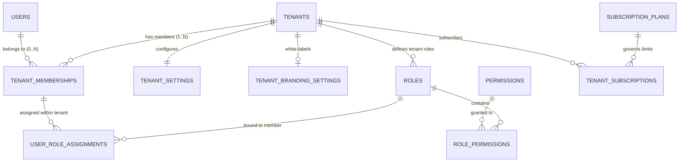
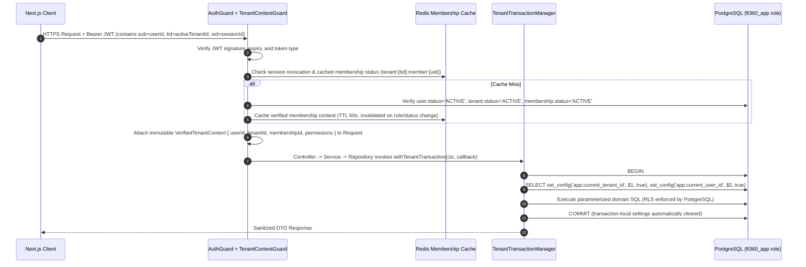

# Multi-Tenant Architecture

**Last Updated:** 2026-11-12  
**Status:** Mandatory Architecture Specification  
**Version:** 0.1.0

---

## 1. Tenancy Model Overview

The platform implements a **Shared Application, Shared PostgreSQL Database, Shared Schema** multi-tenant model hardened with **Application-Layer Context Validation** + **PostgreSQL Row-Level Security (RLS)**.

- **Platform Scope (Global):** Managed exclusively by Platform Super Admins (`tenants`, `users`, `platform_roles`, `subscription_plans`, `platform_branding_settings`, `platform_audit_logs`).
- **Membership Bridge Scope:** Links global `users` to one or many `tenants` (`tenant_memberships`).
- **Tenant Scope (Isolated):** Owned by a single organization (`tenant_id NOT NULL`), protected by composite foreign keys and RLS (`roles`, `user_role_assignments`, `tenant_settings`, `tenant_branding_settings`, `leads`, `contacts`, `accounts`, `campaigns`, `calls`, `employees`, `invoices`, `tenant_audit_logs`, etc.).

---

## 2. Multi-Organization Identity & Tenant Relationship Diagram

A single `User` (identified by email/identity) can belong to **multiple** `Tenants` simultaneously with completely independent roles in each organization (e.g., `Sales Manager` in Tenant A and `Read-Only Auditor` in Tenant B).

---

## 3. End-to-End Tenant Context Resolution Flow

**Golden Rule:** `tenant_id` supplied in request bodies, query strings, or unverified headers is **NEVER** trusted.

### Multi-Tenant Switching Flow
1. User authenticates via `POST /api/v1/auth/login`.
2. Backend returns authenticated user profile + list of active `tenant_memberships`.
   - If the user belongs to **1** active tenant, session tokens are issued scoped to that `tid`.
   - If the user belongs to **multiple** active tenants, session starts in workspace-selection state until `POST /api/v1/auth/switch-tenant` is called with a target `tenantId`.
3. `switch-tenant` validates active membership in PostgreSQL, logs a tenant-switch audit event, and issues a fresh short-lived access token bound to the newly verified `tid`.

---

## 4. Connection Pool Safety & Prevention of Context Leakage

Using `pg.Pool` safely with RLS requires strict transaction scoping:

1. **Prohibited Pattern:** Never run session-level `SET app.current_tenant_id = '...'` on a pooled client outside a transaction, because an unhandled exception before `RESET` could leave the variable set for the next borrower.
2. **Mandatory Pattern:** Always use `set_config('app.current_tenant_id', $1, true)` inside an explicit `BEGIN ... COMMIT/ROLLBACK` block via `TenantDatabaseService`. Passing `is_local = true` binds the setting strictly to the current transaction; PostgreSQL guarantees it vanishes the instant `COMMIT` or `ROLLBACK` executes.
3. **Belt-and-Suspenders Pool Hygiene:** In `TenantDatabaseService`, the `finally` block always executes `ROLLBACK` on error prior to `client.release()`, and any un-scoped query against a tenant table fails closed (`NULLIF(current_setting('app.current_tenant_id', true), '')::uuid` evaluates to `NULL`, matching zero rows).

---

## 5. Non-Database Tenant Isolation Boundaries

Tenant isolation applies equally across all auxiliary subsystems:

| Subsystem | Isolation Mechanism |
|---|---|
| **Redis Cache** | Mandatory helper `TenantCacheKey.build(tenantId, namespace, key)` -> `t:{tenantId}:{namespace}:{key}`. Raw `redis.get/set` barred outside `CacheService`. |
| **BullMQ Background Jobs** | Every job data envelope requires `BaseTenantJobPayload { tenantId, actorUserId, correlationId }`. Base worker processor re-verifies tenant is `ACTIVE` before starting DB transaction. |
| **S3 Object Storage** | Object keys strictly namespaced: `tenants/{tenantId}/{module}/{yyyy}/{mm}/{uuidv7}-{sanitizedFilename}`. Direct bucket URLs are disabled; downloads require backend-authorized short-lived pre-signed URLs (TTL <= 5 min) after RBAC + tenant ownership verification. |
| **Exports & Reports** | Generated asynchronously per tenant, written to `tenants/{tenantId}/exports/...`, recorded in `export_jobs` table under RLS, and downloadable only by authorized members of that same `tenantId`. |
| **WebSockets / Real-Time** | Socket handshake validates JWT + `tenant_memberships`; rooms strictly prefixed `tenant:{tenantId}:...`; re-validated on token refresh or membership revocation. |
| **Search & Analytics** | All search queries (full-text `tsvector` / trigram indexes) include `tenant_id` as the leading partition/index predicate and execute inside RLS transactions. |

