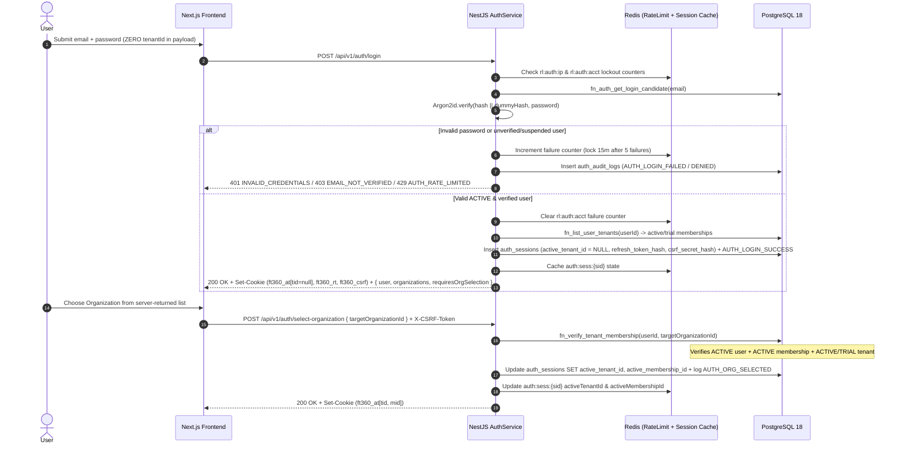
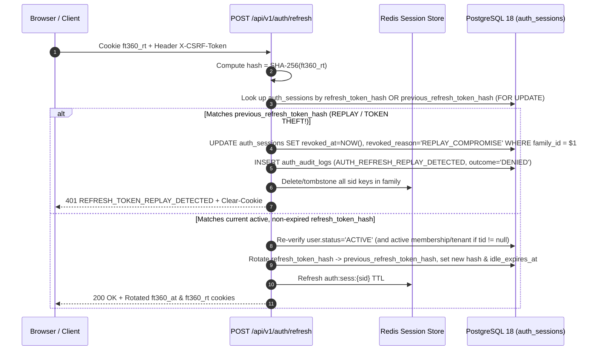
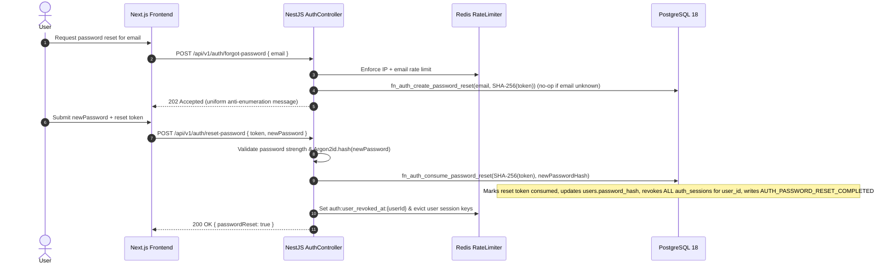
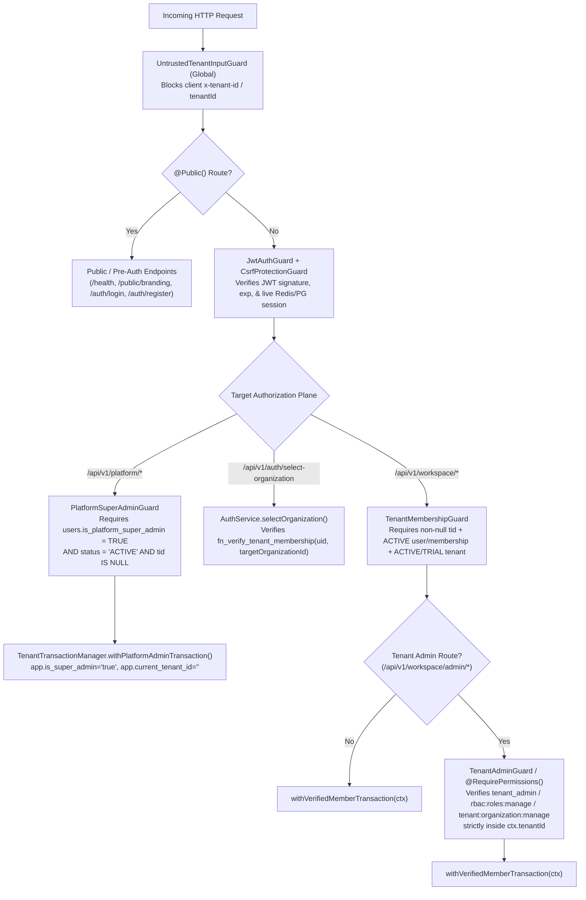

# Phase 3 – Authentication, Session Management & Authorization Boundaries Architecture

**Last Updated:** 2026-11-13  
**Status:** Approved & Implemented in Phase 3 (`migrations 0001–0005`, Backend Auth/Boundary Modules & Next.js 15 Auth UI Verified)  
**Version:** 0.3.1  
**Prepared By:** Tushar (Architecture & DB), Mansi (Auth & Security QA), Nakshatra (Multi-Org UX & Tenant Boundaries)

---

## 1. Review of Existing Phase 1 & Phase 2 Foundation

Phase 3 builds directly atop the verified Phase 1 and Phase 2 primitives **without modifying or breaking any existing schema objects (`0001`–`0004`)**:

| Existing Component | Phase 1 / 2 Guarantee Preserved | Phase 3 Integration Role |
|---|---|---|
| `public.users` (`0003`) | `UUIDv7` PK, `CITEXT` unique email, `status` (`PENDING`, `ACTIVE`, `SUSPENDED`, `ARCHIVED`), `email_verified`, `is_platform_super_admin`, **column-level `SELECT` omitting `password_hash`** (`42501` on direct read) | Stores Argon2id hashes via narrow `SECURITY DEFINER` auth routines; global identity remains decoupled from single tenants. |
| `public.tenants` & `public.tenant_memberships` (`0003`) | `FORCE RLS`, composite anchor `uq_tenant_memberships_tenant_id_id (tenant_id, id)`, `fn_verify_tenant_membership`, `fn_list_user_tenants` | Drives post-login organization discovery and binds `auth_sessions.(active_tenant_id, active_membership_id)` via composite FK. |
| `public.permissions`, `roles`, `role_permissions`, `user_role_assignments` (`0004`) | Canonical `scope_plane` (`PLATFORM`, `TENANT`, `PORTAL`), 4 composite FKs, `trigger_protect_system_roles`, `RbacRepository` | Powers `TenantAdminGuard` and `@RequirePermissions()` inside verified tenant transactions. |
| `UntrustedTenantInputGuard` | Rejects client-supplied `x-tenant-id`, `x-org-id`, `tenantId`, and `tenant_id` across all routes (`400 UNTRUSTED_TENANT_INPUT_REJECTED`) | Preserved globally; organization selection uses dedicated `/api/v1/auth/select-organization` with payload `{ targetOrganizationId }` verified against `fn_verify_tenant_membership`. |
| `TenantMembershipGuard` & `TenantTransactionManager` | Fail-closed UUID validation, `withVerifiedMemberTransaction`, `withPlatformAdminTransaction`, `client.release(true)` broken-socket eviction | Receives verified `req.authSession` from `JwtAuthGuard`; enforces `ACTIVE` user + `ACTIVE` membership + `ACTIVE`/`TRIAL` tenant on every request. |
| `RedisService` | `ioredis` cache DB (`db: 0`) + BullMQ queue DB (`db: 1`), `t:{tenantId}:*` tenant key isolation | Extended with dedicated `auth:*` and `rl:auth:*` namespaces for instant session revocation and atomic login rate limiting. |

---

## 2. Cryptographic, Token, Cookie & CSRF Architecture

### 2.1 Argon2id Password Hashing & Anti-Enumeration
- **Algorithm:** `Argon2id` (`memoryCost = 65536` [64 MiB], `timeCost = 3`, `parallelism = 4`, 16-byte CSPRNG salt).
- **Password Policy:** Minimum `12` characters, maximum `128` characters (preventing CPU DoS), requiring uppercase, lowercase, digit, and symbol; whitespace-only or email-matching passwords rejected.
- **Timing Side-Channel Defense:** When `POST /api/v1/auth/login` receives an unknown email, `PasswordHashService` executes `argon2.verify()` against a precomputed startup dummy Argon2id hash before returning the exact same `401 INVALID_CREDENTIALS` envelope.
- **Zero Hash Exposure:** `ft360_app` retains zero `SELECT` privilege on `users.password_hash`. Only narrow `SECURITY DEFINER` SQL functions (`WHERE public.app_current_tenant_id() IS NULL`) can read or update `password_hash` during login, registration, and password reset.

### 2.2 Hybrid Access JWT + Rotating Opaque Refresh Session
1. **Access Token (`15 min` TTL, Ed25519 / HMAC-SHA256 via Node `node:crypto`):**
   - Claims:
     - `sub`: `userId` (`UUID`)
     - `sid`: `sessionId` (`UUID` in `public.auth_sessions`)
     - `tid`: `activeTenantId` (`UUID | null` — `null` prior to org selection or when operating in Platform Control Plane)
     - `mid`: `activeMembershipId` (`UUID | null`)
     - `padmin`: `boolean` (`is_platform_super_admin` hint — **always re-verified in PostgreSQL** by `PlatformSuperAdminGuard` and `withPlatformAdminTransaction`)
     - `jti`, `iat`, `exp`, `iss`, `aud`
2. **Opaque Refresh Token (`7 days` idle TTL / `30 days` absolute session family TTL):**
   - Generated as `32 bytes` (`256 bits`) from `crypto.randomBytes(32)` (`base64url` encoded).
   - **Never stored in plaintext:** Only `SHA-256(rawRefreshToken)` (`CHAR(64)`) is stored in `public.auth_sessions.refresh_token_hash`.
   - **Strict Single-Use Rotation + Family Replay Detection:**
     - Each `POST /api/v1/auth/refresh` atomically rotates `refresh_token_hash` (storing the retired hash in `previous_refresh_token_hash` / session lineage under `family_id`).
     - If an already-rotated refresh token is presented again (**token theft / replay**), the backend immediately revokes **every session sharing `family_id`** in PostgreSQL + Redis, clears cookies, and writes a high-severity `AUTH_REFRESH_REPLAY_DETECTED` audit record.

### 2.3 Secure Cookie Transport & Double-Submit CSRF Protection
- **Browser Cookie Contract:**
  - `ft360_at`: `HttpOnly; Path=/; SameSite=Lax; Max-Age=900` (`Secure` enabled whenever `NODE_ENV=production` or `COOKIE_SECURE=true`).
  - `ft360_rt`: `HttpOnly; Path=/api/v1/auth; SameSite=Strict; Max-Age=604800` (sent **only** to `/api/v1/auth/*` endpoints, minimizing exposure surface).
  - `ft360_csrf`: Non-`HttpOnly` (`SameSite=Lax; Path=/`) readable by the Next.js frontend containing an HMAC-bound CSRF token tied to `sid`, paired with required request header `X-CSRF-Token`.
- **`CsrfProtectionGuard`:**
  - Enforced on all mutating HTTP methods (`POST`, `PUT`, `PATCH`, `DELETE`) whenever authentication relies on cookies (or pre-session cookie-setting auth endpoints via `Origin` allowlist check).
  - Validates both: (1) `Origin` / `Referer` matches `CORS_ALLOWED_ORIGINS`, and (2) `X-CSRF-Token` header matches the cryptographic `csrf_secret_hash` of the active session in constant time (`crypto.timingSafeEqual`).
- **Dual Transport Support for API/Swagger Clients:** `JwtAuthGuard` accepts either `ft360_at` cookie (with mandatory CSRF protection on mutations) or `Authorization: Bearer <accessToken>` header (inherently immune to browser ambient-cookie CSRF). **Raw refresh secrets and password hashes are never returned in JSON bodies under default browser mode.**

---

## 3. Authentication Workflows & Sequence Diagrams

### 3.1 Registration & Email Verification Workflow
```mermaid
sequenceDiagram
    autonumber
    actor User
    participant Web as Next.js Frontend
    participant API as NestJS AuthController
    participant RL as Redis RateLimiter
    participant PG as PostgreSQL 18 (ft360_app)
    participant Mail as Outbox / Mailer Job

    User->>Web: Submit Register Form (fullName, email, password)
    Web->>API: POST /api/v1/auth/register
    API->>RL: Check IP + email registration rate limit
    API->>API: Validate password policy & Argon2id.hash(password)
    API->>API: Generate 256-bit verify token -> SHA-256(token)
    API->>PG: fn_auth_register_user (INSERT users[PENDING, email_verified=false] + email_verification_tokens + auth_audit_logs)
    API->>Mail: Enqueue BullMQ verification email job (token link)
    API-->>Web: 201 Created (user summary; no secrets/tokens in body)

    User->>Web: Click /verify-email?token=<rawToken>
    Web->>API: POST /api/v1/auth/verify-email { token }
    API->>PG: fn_auth_consume_email_verification(SHA-256(token))
    Note over PG: Marks token consumed_at=NOW(), users.email_verified=TRUE, users.status='ACTIVE', logs AUTH_EMAIL_VERIFIED
    API-->>Web: 200 OK { verified: true }
```

### 3.2 Login, Rate Limiting & Multi-Tenant Organization Selection


### 3.3 Refresh Token Rotation & Replay/Theft Detection


### 3.4 Forgot-Password & Password-Reset Workflow


### 3.5 Platform Super Admin vs Tenant Admin Authorization Boundaries


**Strict Plane Isolation Guarantees:**
1. **Platform Super Admin Boundary (`/api/v1/platform/*`):**
   - Requires `is_platform_super_admin = TRUE` verified live in PostgreSQL AND `activeTenantId === null` (pure platform control-plane context).
   - A Platform Super Admin **cannot** hit `/api/v1/workspace/*` unless they hold a real, active `tenant_memberships` row in that tenant and explicitly select that organization via `/api/v1/auth/select-organization`.
   - Any Tenant Admin or regular member calling `/api/v1/platform/*` is rejected with `403 PLATFORM_SUPER_ADMIN_REQUIRED` and logged in `auth_audit_logs` (`outcome = 'DENIED'`).
2. **Tenant Admin Boundary (`/api/v1/workspace/admin/*`):**
   - Requires `JwtAuthGuard` → `TenantMembershipGuard` → `TenantAdminGuard` (checking `tenant:organization:manage` or `rbac:roles:manage` via `RbacRepository.listEffectivePermissionsForMembership(tx, tenantId, membershipId)`).
   - A user who is **Tenant Admin in Tenant A** and **Standard Member in Tenant B** passes `TenantAdminGuard` when `sid` is bound to Tenant A, and is strictly rejected with `403 INSUFFICIENT_TENANT_PERMISSIONS` when `sid` is bound to Tenant B.

---

## 4. Required Database Schema Changes (Migration `0005`)

All Phase 2 tables (`users`, `tenants`, `tenant_memberships`, `permissions`, `roles`, `role_permissions`, `user_role_assignments`) remain **100% intact**. Migration `db/migrations/0005_authentication_sessions_tokens_and_audit.{up,down}.sql` (owned by `ft360_migrator`, `ENABLE` + `FORCE ROW LEVEL SECURITY` on all tables) introduces:

### 4.1 New Tables
1. **`public.auth_sessions`**
   - `id UUID PRIMARY KEY DEFAULT uuidv7()`
   - `family_id UUID NOT NULL`
   - `user_id UUID NOT NULL REFERENCES public.users(id) ON DELETE CASCADE`
   - `active_tenant_id UUID NULL REFERENCES public.tenants(id) ON DELETE SET NULL`
   - `active_membership_id UUID NULL`
   - **Composite FK `fk_auth_sessions_active_membership`:** `FOREIGN KEY (active_tenant_id, active_membership_id) REFERENCES public.tenant_memberships(tenant_id, id) ON DELETE SET NULL (active_membership_id)`
   - **Check `chk_auth_sessions_tenant_member_pair`:** `(active_tenant_id IS NULL AND active_membership_id IS NULL) OR (active_tenant_id IS NOT NULL AND active_membership_id IS NOT NULL)`
   - `refresh_token_hash CHAR(64) NOT NULL UNIQUE`
   - `previous_refresh_token_hash CHAR(64) NULL`
   - `csrf_secret_hash CHAR(64) NOT NULL`
   - `ip_address INET NULL`, `user_agent VARCHAR(512) NULL`
   - `last_active_at TIMESTAMPTZ NOT NULL DEFAULT NOW()`, `idle_expires_at TIMESTAMPTZ NOT NULL`, `expires_at TIMESTAMPTZ NOT NULL`
   - `revoked_at TIMESTAMPTZ NULL`, `revoked_reason VARCHAR(64) NULL`
   - `created_at TIMESTAMPTZ NOT NULL DEFAULT NOW()`, `updated_at TIMESTAMPTZ NOT NULL DEFAULT NOW()`
   - **Indexes:** `(user_id, revoked_at, expires_at DESC)`, `(family_id)`, `(previous_refresh_token_hash) WHERE previous_refresh_token_hash IS NOT NULL`, `(active_tenant_id, active_membership_id) WHERE active_tenant_id IS NOT NULL`.
   - **RLS:** Fail-closed (`0` rows unscoped); user can read/update/revoke own sessions (`user_id = public.app_current_user_id() AND public.app_current_tenant_id() IS NULL`), Platform Super Admin can inspect/revoke sessions in platform plane.

2. **`public.email_verification_tokens`**
   - `id UUID PRIMARY KEY DEFAULT uuidv7()`, `user_id UUID NOT NULL REFERENCES public.users(id) ON DELETE CASCADE`, `token_hash CHAR(64) NOT NULL UNIQUE`, `expires_at TIMESTAMPTZ NOT NULL`, `consumed_at TIMESTAMPTZ NULL`, `requested_ip INET NULL`, `created_at TIMESTAMPTZ NOT NULL DEFAULT NOW()`.
   - **Indexes:** `(user_id, consumed_at, expires_at DESC)`.
   - **RLS:** `ENABLE` + `FORCE ROW LEVEL SECURITY`; accessed exclusively via narrow `SECURITY DEFINER` verification routines (`0` direct `SELECT` exposure to tenant queries).

3. **`public.password_reset_tokens`**
   - `id UUID PRIMARY KEY DEFAULT uuidv7()`, `user_id UUID NOT NULL REFERENCES public.users(id) ON DELETE CASCADE`, `token_hash CHAR(64) NOT NULL UNIQUE`, `expires_at TIMESTAMPTZ NOT NULL`, `consumed_at TIMESTAMPTZ NULL`, `requested_ip INET NULL`, `consumed_ip INET NULL`, `created_at TIMESTAMPTZ NOT NULL DEFAULT NOW()`.
   - **Indexes:** `(user_id, consumed_at, expires_at DESC)`.
   - **RLS:** `ENABLE` + `FORCE ROW LEVEL SECURITY`; accessed exclusively via narrow `SECURITY DEFINER` reset routines (`0` direct `SELECT` exposure to tenant queries).

4. **`public.auth_audit_logs`** *(Append-Only Authentication & Authorization Security Ledger)*
   - `id UUID PRIMARY KEY DEFAULT uuidv7()`
   - `event_type VARCHAR(64) NOT NULL`
   - `outcome VARCHAR(16) NOT NULL CHECK (outcome IN ('SUCCESS', 'FAILURE', 'DENIED'))`
   - `actor_user_id UUID NULL REFERENCES public.users(id) ON DELETE SET NULL`
   - `target_user_id UUID NULL REFERENCES public.users(id) ON DELETE SET NULL`
   - `tenant_id UUID NULL REFERENCES public.tenants(id) ON DELETE SET NULL`
   - `session_id UUID NULL`
   - `correlation_id UUID NOT NULL`
   - `ip_address INET NULL`, `user_agent VARCHAR(512) NULL`
   - `metadata JSONB NOT NULL DEFAULT '{}'::jsonb` (with `CHECK` blocking forbidden keys `password`, `passwordHash`, `refreshToken`, `accessToken`, `token`)
   - `created_at TIMESTAMPTZ NOT NULL DEFAULT NOW()`
   - **Immutability:** `GRANT SELECT, INSERT ON public.auth_audit_logs TO ft360_app` (`UPDATE` and `DELETE` omitted) + `BEFORE UPDATE OR DELETE` trigger raising `42501`.
   - **RLS:**
     - `INSERT`: permitted via narrow `fn_record_auth_audit_log` or scoped transaction.
     - `SELECT`: `public.app_is_super_admin()` sees platform/global auth logs; verified tenant transactions (`tenant_id IS NOT NULL AND tenant_id = public.app_current_tenant_id()`) see **only** events for their own `tenant_id`; unscoped queries return `0` rows.

### 4.2 Narrow `SECURITY DEFINER` Auth Routines (Preserving Zero `password_hash` `SELECT` Grant)
All routines pin `SET search_path = pg_catalog, public, pg_temp`, `REVOKE ALL FROM PUBLIC`, `GRANT EXECUTE TO ft360_app`, and assert `public.app_current_tenant_id() IS NULL` so **no tenant workspace transaction can ever invoke them**:
- `public.fn_auth_register_user(...)`: Atomically inserts `PENDING` user (`is_platform_super_admin = FALSE`, `email_verified = FALSE`) + `email_verification_tokens` row.
- `public.fn_auth_get_login_candidate(p_email CITEXT)`: Returns `(user_id, email, full_name, password_hash, status, email_verified, is_platform_super_admin)` solely to the pre-tenant login service for in-memory Argon2id verification; `AuthService` strips `password_hash` immediately upon boolean verification.
- `public.fn_auth_verify_email_token(p_token_hash CHAR(64))`: Atomically consumes an unexpired verification token and activates `PENDING` user + sets `email_verified = TRUE`.
- `public.fn_auth_issue_email_verification_token(p_email CITEXT, p_token_hash CHAR(64), p_ttl_seconds INT, p_ip INET)`
- `public.fn_auth_issue_password_reset_token(p_email CITEXT, p_token_hash CHAR(64), p_ttl_seconds INT, p_ip INET)`
- `public.fn_auth_reset_password(p_token_hash CHAR(64), p_new_password_hash TEXT, p_ip INET)`: Atomically consumes single-use reset token, updates `users.password_hash`, and revokes all active `auth_sessions` for that `user_id`.
- `public.fn_record_auth_audit_log(...)`: Writes append-only `auth_audit_logs` entries across pre-auth, tenant, and platform planes.

### 4.3 Seeded Canonical Permissions (`public.permissions`)
- `platform:users:read` (`PLATFORM`, `M01`), `platform:users:manage` (`PLATFORM`, `M01`), `platform:audit:read` (`PLATFORM`, `M01`)
- `auth:sessions:manage` (`TENANT`, `M03`), `audit:auth:read` (`TENANT`, `M31`)

---

## 5. API Endpoint Surface & Next.js Frontend Flows

### 5.1 Backend Endpoints (`/api/v1`)
| Method & Path | Guards | Purpose |
|---|---|---|
| `POST /api/v1/auth/register` | `@Public()`, `AuthRateLimitGuard` | Self-service user registration (`PENDING`, Argon2id, verification token queued) |
| `POST /api/v1/auth/verify-email` | `@Public()`, `AuthRateLimitGuard` | Single-use SHA-256 email verification (`email_verified=true`, `status='ACTIVE'`) |
| `POST /api/v1/auth/resend-verification` | `@Public()`, `AuthRateLimitGuard` | Anti-enumeration resend of verification token |
| `POST /api/v1/auth/login` | `@Public()`, `AuthRateLimitGuard` | Argon2id verification, session creation, `HttpOnly` cookies, workspace list |
| `POST /api/v1/auth/refresh` | `@Public()` (uses `ft360_rt`), `CsrfProtectionGuard`, `AuthRateLimitGuard` | Single-use refresh token rotation + replay family revocation |
| `POST /api/v1/auth/logout` | `JwtAuthGuard` (or `ft360_rt`), `CsrfProtectionGuard` | Revokes current session in PG + Redis and clears cookies |
| `POST /api/v1/auth/logout-all` | `JwtAuthGuard`, `CsrfProtectionGuard` | Revokes all active sessions for current user across devices |
| `POST /api/v1/auth/forgot-password` | `@Public()`, `AuthRateLimitGuard` | Anti-enumeration `202 Accepted` single-use reset token issuance |
| `POST /api/v1/auth/reset-password` | `@Public()`, `AuthRateLimitGuard` | Resets Argon2id password and revokes all user sessions |
| `GET /api/v1/auth/me` | `JwtAuthGuard` | Returns authenticated user profile, current `activeTenant` (if selected), available active organizations, and effective plane flags |
| `GET /api/v1/auth/sessions` | `JwtAuthGuard` | Lists user's active device sessions (redacted — zero token hashes) |
| `DELETE /api/v1/auth/sessions/:sessionId` | `JwtAuthGuard`, `CsrfProtectionGuard` | Revokes a specific session belonging to current user |
| `POST /api/v1/auth/select-organization` | `JwtAuthGuard`, `CsrfProtectionGuard` | Verifies `{ targetOrganizationId }` via `fn_verify_tenant_membership`, binds session `(active_tenant_id, active_membership_id)`, re-issues `ft360_at` |
| `POST /api/v1/auth/exit-organization` | `JwtAuthGuard`, `CsrfProtectionGuard` | Clears `active_tenant_id` / `active_membership_id` on session (`tid = null`) |
| `GET /api/v1/platform/auth/overview` & `GET /api/v1/platform/audit/auth-logs` | `JwtAuthGuard`, `PlatformSuperAdminGuard` | Verifies Platform Super Admin authorization boundary & platform auth audit feed |
| `GET /api/v1/workspace/context` | `JwtAuthGuard`, `TenantMembershipGuard` | Verifies authenticated tenant member boundary (`req.tenantContext`) |
| `GET /api/v1/workspace/admin/auth-logs` | `JwtAuthGuard`, `TenantMembershipGuard`, `TenantAdminGuard` | Verifies Tenant Admin authorization boundary & tenant-isolated auth audit feed |

### 5.2 Next.js 15 App Router Pages (`apps/web/src/app`)
*(Strictly authentication, identity, and boundary verification UI — zero CRM or business module screens)*:
- `/register` — White-label branded registration form with client + server validation.
- `/verify-email` — Email verification confirmation flow (+ dev-mode local outbox link helper strictly gated to `NODE_ENV !== 'production'`).
- `/login` — White-label login page handling invalid credentials, unverified-email prompt, and `429` lockout countdown.
- `/forgot-password` & `/reset-password` — Anti-enumeration recovery and password reset flow.
- `/select-organization` — Post-login multi-tenant organization picker (and Platform Control Plane entry option for verified Super Admins).
- `/workspace` & `/workspace/admin` — Authenticated workspace identity/session management panel + Tenant Admin boundary verification view (active sessions, organization switcher, tenant auth audit feed).
- `/platform` — Authenticated Platform Super Admin identity & global auth audit boundary view (`403` blocked for non-super-admins).

