# Initial Database Entity-Relationship (ER) Diagrams

**Last Updated:** 2026-11-12  
**Status:** Phase 0 Database Design Baseline  
**Version:** 0.1.0

---

## 1. Foundation Domain ER Diagram (Phases 2–7)

This ER diagram covers the mandatory platform, multi-tenant identity, RBAC, branding, subscription, and audit entities required before business modules begin.

```mermaid
erDiagram
    PLATFORM_BRANDING_SETTINGS {
        uuid id PK
        varchar product_name
        varchar tagline
        text logo_light_url
        text logo_dark_url
        text favicon_url
        varchar primary_color_hex
        varchar accent_color_hex
        varchar support_email
        varchar website_url
        timestamptz updated_at
    }

    USERS {
        uuid id PK
        citext email UK
        text password_hash
        varchar full_name
        varchar phone_e164
        varchar status "PENDING | ACTIVE | SUSPENDED | ARCHIVED"
        boolean is_platform_super_admin
        boolean email_verified
        timestamptz last_login_at
        timestamptz created_at
        timestamptz updated_at
    }

    AUTH_SESSIONS {
        uuid id PK
        uuid user_id FK
        uuid active_tenant_id FK "Nullable before tenant selection"
        text refresh_token_hash UK
        uuid token_family_id
        inet ip_address
        text user_agent
        timestamptz expires_at
        timestamptz revoked_at
        timestamptz created_at
    }

    TENANTS {
        uuid id PK
        citext slug UK
        varchar legal_name
        varchar display_name
        varchar status "PROVISIONING | TRIAL | ACTIVE | SUSPENDED | CANCELLED"
        varchar default_timezone
        char default_currency "ISO-4217"
        timestamptz activated_at
        timestamptz suspended_at
        timestamptz created_at
        timestamptz updated_at
    }

    TENANT_SETTINGS {
        uuid tenant_id PK,FK
        boolean enforce_mfa
        int session_idle_timeout_minutes
        jsonb allowed_ip_cidrs
        jsonb feature_flags
        jsonb business_hours
        timestamptz updated_at
    }

    TENANT_BRANDING_SETTINGS {
        uuid tenant_id PK,FK
        varchar custom_product_name
        text logo_light_url
        text logo_dark_url
        text favicon_url
        varchar primary_color_hex
        varchar accent_color_hex
        varchar support_email
        citext custom_domain UK
        timestamptz updated_at
    }

    TENANT_MEMBERSHIPS {
        uuid id PK
        uuid tenant_id FK
        uuid user_id FK
        varchar membership_type "INTERNAL | CLIENT_PORTAL | PARTNER"
        varchar status "INVITED | ACTIVE | SUSPENDED | REVOKED"
        varchar job_title
        varchar employee_code
        uuid invited_by_user_id FK
        timestamptz joined_at
        timestamptz created_at
        timestamptz updated_at
    }

    PERMISSIONS {
        uuid id PK
        varchar code UK "e.g. crm:leads:read"
        varchar scope_plane "PLATFORM | TENANT | PORTAL"
        varchar module_code
        text description
        timestamptz created_at
    }

    ROLES {
        uuid id PK
        uuid tenant_id FK
        varchar slug
        varchar name
        text description
        boolean is_system_role
        varchar data_access_scope "OWN | TEAM | TENANT"
        timestamptz created_at
        timestamptz updated_at
    }

    ROLE_PERMISSIONS {
        uuid tenant_id PK,FK
        uuid role_id PK,FK
        uuid permission_id PK,FK
        timestamptz granted_at
    }

    USER_ROLE_ASSIGNMENTS {
        uuid id PK
        uuid tenant_id FK
        uuid membership_id FK
        uuid role_id FK
        uuid assigned_by_user_id FK
        timestamptz created_at
    }

    SUBSCRIPTION_PLANS {
        uuid id PK
        varchar code UK
        varchar name
        varchar billing_interval "MONTHLY | ANNUAL | CUSTOM"
        numeric base_price
        char currency_code
        jsonb entitlements_json "seat limits, storage_gb, modules"
        boolean is_active
        timestamptz created_at
    }

    TENANT_SUBSCRIPTIONS {
        uuid id PK
        uuid tenant_id FK
        uuid plan_id FK
        varchar status "TRIALING | ACTIVE | PAST_DUE | CANCELLED"
        int seat_limit_override
        timestamptz current_period_start
        timestamptz current_period_end
        timestamptz created_at
        timestamptz updated_at
    }

    PLATFORM_AUDIT_LOGS {
        uuid id PK
        uuid actor_user_id FK
        uuid target_tenant_id FK
        varchar action
        varchar entity_type
        uuid entity_id
        jsonb metadata_json
        inet ip_address
        uuid correlation_id
        timestamptz created_at
    }

    TENANT_AUDIT_LOGS {
        uuid id PK
        uuid tenant_id FK
        uuid actor_user_id FK
        uuid actor_membership_id FK
        varchar action
        varchar entity_type
        uuid entity_id
        jsonb before_state
        jsonb after_state
        inet ip_address
        uuid correlation_id
        timestamptz created_at
    }

    USERS ||--o{ AUTH_SESSIONS : "authenticates"
    TENANTS ||--o{ AUTH_SESSIONS : "active context"
    USERS ||--o{ TENANT_MEMBERSHIPS : "joins"
    TENANTS ||--o{ TENANT_MEMBERSHIPS : "contains"
    TENANTS ||--|| TENANT_SETTINGS : "has"
    TENANTS ||--o| TENANT_BRANDING_SETTINGS : "customizes"
    TENANTS ||--o{ ROLES : "owns"
    ROLES ||--o{ ROLE_PERMISSIONS : "maps"
    PERMISSIONS ||--o{ ROLE_PERMISSIONS : "included in"
    TENANT_MEMBERSHIPS ||--o{ USER_ROLE_ASSIGNMENTS : "receives"
    ROLES ||--o{ USER_ROLE_ASSIGNMENTS : "assigned as"
    SUBSCRIPTION_PLANS ||--o{ TENANT_SUBSCRIPTIONS : "defines"
    TENANTS ||--o{ TENANT_SUBSCRIPTIONS : "holds"
    USERS ||--o{ PLATFORM_AUDIT_LOGS : "triggers"
    TENANTS ||--o{ TENANT_AUDIT_LOGS : "isolates"
```

---

## 2. Core Business Domain Preview (Post-Foundation Modules)

Once Phases 0–9 (Foundation) are approved and released, every subsequent business domain table (`accounts`, `contacts`, `leads`, `pipelines`, `opportunities`, `campaigns`, `dbms_records`, `call_detail_records`, `qa_scorecards`, `employees`, `invoices`, `client_projects`) attaches cleanly to `tenants(id)` and `tenant_memberships(tenant_id, id)` using composite foreign keys and identical RLS policies.

