# Database Entity-Relationship (ER) Diagrams

**Last Updated:** 2026-11-13  
**Status:** Phase 3 Implemented Baseline (`migrations 0001–0006`) + Phases 4–7 Planned Extensions  
**Version:** 0.3.1

---

## 1. Implemented Foundation ER Diagram (Phases 1–3: Migrations `0001`–`0006`)

All 15 application entities below (plus `schema_migrations`) are live in PostgreSQL 18, owned by `ft360_migrator`, and protected by `ENABLE` + `FORCE ROW LEVEL SECURITY` and composite foreign keys:

```mermaid
erDiagram
    PLATFORM_BRANDING_SETTINGS {
        boolean singleton_key PK
        varchar product_name
        varchar tagline
        varchar support_email
        varchar website_url
        text logo_light_url
        text logo_dark_url
        text favicon_url
        char primary_color_hex
        char accent_color_hex
        timestamptz created_at
        timestamptz updated_at
    }

    RLS_ISOLATION_CANARY {
        uuid id PK
        uuid tenant_id
        varchar probe_label
        uuid created_by_user_id
        timestamptz created_at
    }

    USERS {
        uuid id PK
        citext email UK
        text password_hash
        varchar full_name
        varchar phone_e164
        varchar status "PENDING | ACTIVE | SUSPENDED | ARCHIVED"
        boolean is_platform_super_admin
        boolean email_verified
        timestamptz last_login_at
        timestamptz created_at
        timestamptz updated_at
    }

    TENANTS {
        uuid id PK
        citext slug UK
        varchar legal_name
        varchar display_name
        varchar status "PROVISIONING | TRIAL | ACTIVE | SUSPENDED | CANCELLED"
        varchar default_timezone
        char default_currency "ISO-4217"
        timestamptz activated_at
        timestamptz suspended_at
        timestamptz created_at
        timestamptz updated_at
    }

    TENANT_MEMBERSHIPS {
        uuid id PK
        uuid tenant_id FK "UK(tenant_id, user_id), UK(tenant_id, id)"
        uuid user_id FK
        varchar membership_type "INTERNAL | CLIENT_PORTAL | PARTNER"
        varchar status "INVITED | ACTIVE | SUSPENDED | REVOKED"
        varchar job_title
        varchar employee_code
        uuid invited_by_user_id FK
        timestamptz joined_at
        timestamptz created_at
        timestamptz updated_at
    }

    PERMISSIONS {
        uuid id PK
        varchar code UK "module:resource:action"
        varchar scope_plane "PLATFORM | TENANT | PORTAL"
        varchar module_code
        text description
        timestamptz created_at
        timestamptz updated_at
    }

    ROLES {
        uuid id PK
        uuid tenant_id FK "UK(tenant_id, slug), UK(tenant_id, id)"
        citext slug
        varchar name
        text description
        boolean is_system_role
        varchar data_access_scope "OWN | TEAM | TENANT"
        timestamptz created_at
        timestamptz updated_at
    }

    ROLE_PERMISSIONS {
        uuid id PK
        uuid tenant_id FK
        uuid role_id FK "Composite FK (tenant_id, role_id) -> roles(tenant_id, id)"
        uuid permission_id FK
        timestamptz created_at
        timestamptz updated_at
    }

    USER_ROLE_ASSIGNMENTS {
        uuid id PK
        uuid tenant_id FK
        uuid membership_id FK "Composite FK (tenant_id, membership_id)"
        uuid role_id FK "Composite FK (tenant_id, role_id)"
        uuid assigned_by_membership_id FK "Composite FK (tenant_id, assigned_by_membership_id)"
        timestamptz created_at
        timestamptz updated_at
    }

    AUTH_SESSIONS {
        uuid id PK
        uuid family_id "Refresh rotation lineage"
        uuid user_id FK
        uuid active_tenant_id "Composite FK (active_tenant_id, active_membership_id)"
        uuid active_membership_id "ON DELETE SET NULL"
        char refresh_token_hash UK "SHA-256 hex (omitted from ft360_app SELECT)"
        char previous_refresh_token_hash "Replay detection (omitted from ft360_app SELECT)"
        char csrf_secret_hash "SHA-256 hex (omitted from ft360_app SELECT)"
        inet ip_address
        varchar user_agent
        timestamptz last_active_at
        timestamptz idle_expires_at
        timestamptz expires_at
        timestamptz revoked_at
        varchar revoked_reason
        timestamptz created_at
        timestamptz updated_at
    }

    EMAIL_VERIFICATION_TOKENS {
        uuid id PK
        uuid user_id FK
        char token_hash UK "SHA-256 hex (omitted from ft360_app SELECT)"
        timestamptz expires_at
        timestamptz consumed_at
        inet requested_ip
        timestamptz created_at
    }

    PASSWORD_RESET_TOKENS {
        uuid id PK
        uuid user_id FK
        char token_hash UK "SHA-256 hex (omitted from ft360_app SELECT)"
        timestamptz expires_at
        timestamptz consumed_at
        inet requested_ip
        inet consumed_ip
        timestamptz created_at
    }

    AUTH_AUDIT_LOGS {
        uuid id PK
        varchar event_type
        varchar outcome "SUCCESS | FAILURE | DENIED"
        uuid actor_user_id FK
        uuid target_user_id FK
        uuid tenant_id FK
        uuid session_id FK
        uuid correlation_id
        inet ip_address
        varchar user_agent
        jsonb metadata "chk_auth_audit_logs_no_secret_keys"
        timestamptz created_at
    }

    AUTH_REFRESH_TOKEN_HISTORY {
        uuid id PK
        uuid session_id FK
        uuid family_id
        uuid user_id FK
        char token_hash UK "SHA-256 hex (omitted from ft360_app SELECT)"
        char replaced_by_token_hash "SHA-256 hex (omitted from ft360_app SELECT)"
        timestamptz rotated_at
    }

    AUTH_EMAIL_OUTBOX {
        uuid id PK
        varchar kind "EMAIL_VERIFICATION | PASSWORD_RESET"
        uuid user_id FK
        citext recipient_email
        varchar recipient_full_name
        text encrypted_action_token "AES-256-GCM (omitted from ft360_app SELECT)"
        timestamptz token_expires_at
        varchar status "PENDING | PROCESSING | FAILED_RETRYABLE | SENT | DEAD_LETTER | EXPIRED"
        int attempt_count
        int max_attempts
        timestamptz next_attempt_at
        varchar provider_name
        varchar provider_message_id
        uuid correlation_id
        timestamptz sent_at
        timestamptz created_at
        timestamptz updated_at
    }

    USERS ||--o{ TENANT_MEMBERSHIPS : "joins (0..N orgs)"
    TENANTS ||--o{ TENANT_MEMBERSHIPS : "contains members"
    USERS ||--o{ TENANT_MEMBERSHIPS : "invited_by_user_id"
    TENANTS ||--o{ ROLES : "defines roles"
    ROLES ||--o{ ROLE_PERMISSIONS : "(tenant_id, id) -> (tenant_id, role_id)"
    PERMISSIONS ||--o{ ROLE_PERMISSIONS : "permission_id -> id"
    TENANT_MEMBERSHIPS ||--o{ USER_ROLE_ASSIGNMENTS : "(tenant_id, id) -> (tenant_id, membership_id)"
    ROLES ||--o{ USER_ROLE_ASSIGNMENTS : "(tenant_id, id) -> (tenant_id, role_id)"
    TENANT_MEMBERSHIPS ||--o{ USER_ROLE_ASSIGNMENTS : "assigned_by_membership_id"
    USERS ||--o{ AUTH_SESSIONS : "owns sessions"
    TENANT_MEMBERSHIPS ||--o{ AUTH_SESSIONS : "(tenant_id, id) -> (active_tenant_id, active_membership_id)"
    USERS ||--o{ EMAIL_VERIFICATION_TOKENS : "verifies email"
    USERS ||--o{ PASSWORD_RESET_TOKENS : "recovers password"
    USERS ||--o{ AUTH_AUDIT_LOGS : "actor / target"
    TENANTS ||--o{ AUTH_AUDIT_LOGS : "tenant_id (nullable)"
    AUTH_SESSIONS ||--o{ AUTH_AUDIT_LOGS : "session_id (nullable)"
    AUTH_SESSIONS ||--o{ AUTH_REFRESH_TOKEN_HISTORY : "retains retired RT hashes"
    USERS ||--o{ AUTH_REFRESH_TOKEN_HISTORY : "user_id"
    USERS ||--o{ AUTH_EMAIL_OUTBOX : "transactional mail outbox"
```

---

## 2. Upcoming Foundation Entities (Planned for Phases 4–7)

The following tables attach to `users(id)`, `tenants(id)`, and `tenant_memberships(tenant_id, id)` in subsequent authorized foundation phases:
- **Phase 4 (Tenant Onboarding & Settings):** `tenant_invitations`, `tenant_settings`, `tenant_branding_settings`
- **Phase 6 (Audit & Compliance Core):** `platform_audit_logs`, `tenant_audit_logs`
- **Phase 7 (Subscription Foundation):** `subscription_plans`, `tenant_subscriptions`, `tenant_usage_counters`
