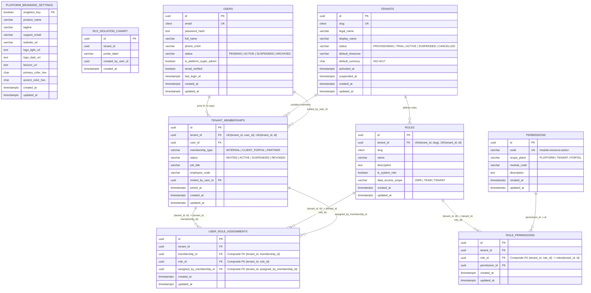

# Database Entity-Relationship (ER) Diagrams

**Last Updated:** 2026-11-13  
**Status:** Phase 2 Implemented Baseline (`migrations 0001–0004`) + Phases 3–7 Planned Extensions  
**Version:** 0.2.0

---

## 1. Implemented Foundation ER Diagram (Phases 1–2: Migrations `0001`–`0004`)

All entities below are live in PostgreSQL 18, owned by `ft360_migrator`, and protected by `ENABLE` + `FORCE ROW LEVEL SECURITY` and composite foreign keys:

---

## 2. Upcoming Foundation Entities (Planned for Phases 3–7)

The following tables attach to `users(id)`, `tenants(id)`, and `tenant_memberships(tenant_id, id)` in subsequent authorized foundation phases:
- **Phase 3 (Authentication):** `auth_sessions`, `password_reset_tokens`
- **Phase 4 (Tenant Onboarding & Settings):** `tenant_invitations`, `tenant_settings`, `tenant_branding_settings`
- **Phase 6 (Audit & Compliance Core):** `platform_audit_logs`, `tenant_audit_logs`
- **Phase 7 (Subscription Foundation):** `subscription_plans`, `tenant_subscriptions`, `tenant_usage_counters`
