# Database Entity-Relationship (ER) Diagrams

**Last Updated:** 2026-11-16  
**Status:** Phase 4 Stage 4A Implemented Baseline (`migrations 0001–0008`) + Phases 5–7 Planned Extensions  
**Version:** 0.4.0

---

## 1. Implemented Foundation ER Diagram (Phases 1–4 Stage 4A: Migrations `0001`–`0008`)

All `22` application entities below (plus `schema_migrations`) are live in PostgreSQL 18, owned by `ft360_migrator` (`ft360_app` owns `0` tables), and protected by `ENABLE` + `FORCE ROW LEVEL SECURITY` and composite foreign keys:

```mermaid
erDiagram
    PLATFORM_BRANDING_SETTINGS {
        boolean singleton_key PK
        varchar product_name
        varchar tagline
        varchar support_email
        varchar website_url
        text logo_light_url
        text logo_dark_url
        text favicon_url
        char primary_color_hex
        char accent_color_hex
        timestamptz created_at
        timestamptz updated_at
    }

    RLS_ISOLATION_CANARY {
        uuid id PK
        uuid tenant_id
        varchar probe_label
        uuid created_by_user_id
        timestamptz created_at
    }

    USERS {
        uuid id PK
        citext email UK "uq_users_email + uq_users_email_normalized + chk_users_email_canonical_trimmed"
        text password_hash "omitted from ft360_app SELECT"
        varchar full_name
        varchar phone_e164
        varchar status "PENDING | ACTIVE | SUSPENDED | ARCHIVED"
        boolean is_platform_super_admin
        boolean email_verified
        timestamptz last_login_at
        timestamptz created_at
        timestamptz updated_at
    }

    TENANTS {
        uuid id PK
        citext slug UK
        varchar legal_name
        varchar display_name
        varchar status "PROVISIONING | TRIAL | ACTIVE | SUSPENDED | DEACTIVATED | CANCELLED"
        varchar default_timezone
        char default_currency "ISO-4217"
        uuid created_by_user_id FK
        timestamptz onboarding_completed_at
        timestamptz activated_at
        timestamptz suspended_at
        timestamptz deactivated_at
        timestamptz cancelled_at
        text status_reason
        timestamptz created_at
        timestamptz updated_at
    }

    TENANT_MEMBERSHIPS {
        uuid id PK
        uuid tenant_id FK "UK(tenant_id, user_id), UK(tenant_id, id)"
        uuid user_id FK
        varchar membership_type "INTERNAL | CLIENT_PORTAL | PARTNER"
        varchar status "INVITED | ACTIVE | SUSPENDED | REVOKED"
        boolean is_primary_owner "Partial UK uq_tenant_memberships_primary_owner"
        varchar job_title
        varchar employee_code
        uuid invited_by_user_id FK
        timestamptz joined_at
        timestamptz suspended_at
        timestamptz revoked_at
        text status_reason
        timestamptz created_at
        timestamptz updated_at
    }

    PERMISSIONS {
        uuid id PK
        varchar code UK "module:resource:action (24 seeded)"
        varchar scope_plane "PLATFORM | TENANT | PORTAL"
        varchar module_code
        text description
        timestamptz created_at
        timestamptz updated_at
    }

    ROLES {
        uuid id PK
        uuid tenant_id FK "UK(tenant_id, slug), UK(tenant_id, id)"
        citext slug
        varchar name
        text description
        boolean is_system_role
        varchar data_access_scope "OWN | TEAM | TENANT"
        timestamptz created_at
        timestamptz updated_at
    }

    ROLE_PERMISSIONS {
        uuid id PK
        uuid tenant_id FK
        uuid role_id FK "Composite FK (tenant_id, role_id) -> roles(tenant_id, id)"
        uuid permission_id FK
        timestamptz created_at
        timestamptz updated_at
    }

    USER_ROLE_ASSIGNMENTS {
        uuid id PK
        uuid tenant_id FK
        uuid membership_id FK "Composite FK (tenant_id, membership_id)"
        uuid role_id FK "Composite FK (tenant_id, role_id)"
        uuid assigned_by_membership_id FK "Composite FK (tenant_id, assigned_by_membership_id)"
        timestamptz created_at
        timestamptz updated_at
    }

    AUTH_SESSIONS {
        uuid id PK
        uuid family_id "Refresh rotation lineage"
        uuid user_id FK
        uuid active_tenant_id "Composite FK (active_tenant_id, active_membership_id)"
        uuid active_membership_id "ON DELETE SET NULL"
        char refresh_token_hash UK "SHA-256 hex (omitted from ft360_app SELECT)"
        char previous_refresh_token_hash "Replay detection (omitted from ft360_app SELECT)"
        char csrf_secret_hash "SHA-256 hex (omitted from ft360_app SELECT)"
        inet ip_address
        varchar user_agent
        timestamptz last_active_at
        timestamptz idle_expires_at
        timestamptz expires_at
        timestamptz revoked_at
        varchar revoked_reason
        timestamptz created_at
        timestamptz updated_at
    }

    EMAIL_VERIFICATION_TOKENS {
        uuid id PK
        uuid user_id FK
        char token_hash UK "SHA-256 hex (omitted from ft360_app SELECT)"
        timestamptz expires_at
        timestamptz consumed_at
        inet requested_ip
        timestamptz created_at
    }

    PASSWORD_RESET_TOKENS {
        uuid id PK
        uuid user_id FK
        char token_hash UK "SHA-256 hex (omitted from ft360_app SELECT)"
        timestamptz expires_at
        timestamptz consumed_at
        inet requested_ip
        inet consumed_ip
        timestamptz created_at
    }

    AUTH_AUDIT_LOGS {
        uuid id PK
        varchar event_type
        varchar outcome "SUCCESS | FAILURE | DENIED"
        uuid actor_user_id FK
        uuid target_user_id FK
        uuid tenant_id FK
        uuid session_id FK
        uuid correlation_id
        inet ip_address
        varchar user_agent
        jsonb metadata "chk_auth_audit_logs_no_secret_keys"
        timestamptz created_at
    }

    AUTH_REFRESH_TOKEN_HISTORY {
        uuid id PK
        uuid session_id FK
        uuid family_id
        uuid user_id FK
        char token_hash UK "SHA-256 hex (omitted from ft360_app SELECT)"
        char replaced_by_token_hash "SHA-256 hex (omitted from ft360_app SELECT)"
        timestamptz rotated_at
    }

    AUTH_EMAIL_OUTBOX {
        uuid id PK
        varchar kind "EMAIL_VERIFICATION | PASSWORD_RESET | TENANT_INVITATION"
        uuid user_id FK "NULL for TENANT_INVITATION (chk_auth_email_outbox_anchor)"
        uuid initiated_by_user_id FK "Inviting actor for TENANT_INVITATION"
        uuid tenant_id "Composite FK (tenant_id, invitation_id)"
        uuid invitation_id "Composite FK -> tenant_invitations(tenant_id, id)"
        citext recipient_email
        varchar recipient_full_name
        text encrypted_action_token "AES-256-GCM (omitted from ft360_app SELECT)"
        timestamptz token_expires_at
        varchar status "PENDING | PROCESSING | FAILED_RETRYABLE | SENT | DEAD_LETTER | EXPIRED"
        int attempt_count
        int max_attempts
        timestamptz next_attempt_at
        varchar provider_name
        varchar provider_message_id
        uuid correlation_id
        timestamptz sent_at
        timestamptz created_at
        timestamptz updated_at
    }

    TENANT_ONBOARDING_STATES {
        uuid tenant_id PK
        varchar status "IN_PROGRESS | COMPLETED"
        varchar current_step "PROFILE | SETTINGS | BRANDING | INVITATIONS | COMPLETED"
        timestamptz profile_completed_at
        timestamptz settings_completed_at
        timestamptz branding_completed_at
        boolean branding_skipped
        timestamptz invitations_completed_at
        boolean invitations_skipped
        timestamptz completed_at
        uuid completed_by_membership_id "Composite FK (tenant_id, completed_by_membership_id)"
        int version
        timestamptz created_at
        timestamptz updated_at
    }

    TENANT_PROFILES {
        uuid tenant_id PK
        varchar industry
        varchar company_size_band
        varchar website_url
        citext primary_contact_email
        varchar primary_contact_phone_e164
        citext billing_email
        char country_code "ISO-3166-1 alpha-2"
        varchar state_region
        varchar city
        varchar postal_code
        varchar address_line_1
        varchar address_line_2
        varchar tax_identifier
        uuid updated_by_membership_id "Composite FK (tenant_id, updated_by_membership_id)"
        int version
        timestamptz created_at
        timestamptz updated_at
    }

    TENANT_SETTINGS {
        uuid tenant_id PK
        varchar default_locale
        varchar date_format
        varchar time_format "12H | 24H"
        smallint week_starts_on
        smallint fiscal_year_start_month
        int invitation_expiry_hours "1..720, default 168 (D3)"
        boolean require_email_verification
        boolean allow_member_directory_view "default false (D4)"
        varchar session_idle_timeout_override_mins
        jsonb feature_preferences "chk_ts_no_secret_keys"
        uuid updated_by_membership_id "Composite FK (tenant_id, updated_by_membership_id)"
        int version
        timestamptz created_at
        timestamptz updated_at
    }

    TENANT_BRANDING_ASSETS {
        uuid id PK
        uuid tenant_id FK "UK(tenant_id, id)"
        varchar asset_kind "LOGO_LIGHT | LOGO_DARK | FAVICON"
        varchar storage_provider "LOCAL | S3"
        varchar storage_key UK
        varchar original_filename
        varchar mime_type "image/png | image/jpeg | image/webp"
        int byte_size
        int width_px
        int height_px
        char sha256_hex
        uuid uploaded_by_membership_id "Composite FK (tenant_id, uploaded_by_membership_id)"
        timestamptz created_at
    }

    TENANT_BRANDING_SETTINGS {
        uuid tenant_id PK
        varchar brand_display_name
        varchar tagline
        citext support_email
        char primary_color_hex
        char accent_color_hex
        uuid logo_light_asset_id "Composite FK (tenant_id, logo_light_asset_id)"
        uuid logo_dark_asset_id "Composite FK (tenant_id, logo_dark_asset_id)"
        uuid favicon_asset_id "Composite FK (tenant_id, favicon_asset_id)"
        varchar email_sender_display_name
        citext email_reply_to
        uuid updated_by_membership_id "Composite FK (tenant_id, updated_by_membership_id)"
        int version
        timestamptz created_at
        timestamptz updated_at
    }

    TENANT_INVITATIONS {
        uuid id PK
        uuid tenant_id FK "UK(tenant_id, id)"
        citext email "Partial UK uq_tenant_invitations_pending_email"
        varchar full_name
        varchar membership_type "INTERNAL | CLIENT_PORTAL | PARTNER"
        uuid role_id "Composite FK (tenant_id, role_id)"
        varchar job_title
        char token_hash UK "SHA-256 hex (omitted from ft360_app SELECT)"
        varchar status "PENDING | ACCEPTED | REVOKED | EXPIRED"
        uuid invited_by_user_id FK "Initiator identity"
        uuid invited_by_membership_id "Composite FK (tenant_id, invited_by_membership_id)"
        uuid accepted_by_user_id FK "Recipient identity (<> invited_by_user_id)"
        uuid accepted_membership_id "Composite FK (tenant_id, accepted_membership_id)"
        uuid revoked_by_membership_id "Composite FK (tenant_id, revoked_by_membership_id)"
        int resend_count
        timestamptz last_sent_at
        timestamptz expires_at
        timestamptz accepted_at
        timestamptz revoked_at
        text revoked_reason
        timestamptz created_at
        timestamptz updated_at
    }

    TENANT_AUDIT_LOGS {
        uuid id PK
        uuid tenant_id FK "UK(tenant_id, id), ON DELETE RESTRICT"
        varchar event_type
        varchar resource_type
        varchar resource_id
        varchar outcome "SUCCESS | FAILURE | DENIED"
        varchar actor_plane "TENANT | PLATFORM | SYSTEM"
        uuid actor_user_id FK
        uuid actor_membership_id "Composite FK (tenant_id, actor_membership_id)"
        uuid target_user_id FK
        uuid target_membership_id "Composite FK (tenant_id, target_membership_id)"
        uuid correlation_id
        inet ip_address
        varchar user_agent
        text reason
        jsonb before_state "chk_tal_no_secret_keys"
        jsonb after_state "chk_tal_no_secret_keys"
        jsonb metadata "chk_tal_no_secret_keys"
        timestamptz created_at
    }

    USERS ||--o{ TENANT_MEMBERSHIPS : "joins (0..N orgs)"
    TENANTS ||--o{ TENANT_MEMBERSHIPS : "contains members"
    USERS ||--o{ TENANT_MEMBERSHIPS : "invited_by_user_id"
    USERS ||--o{ TENANTS : "created_by_user_id"
    TENANTS ||--|| TENANT_ONBOARDING_STATES : "1:1 onboarding state"
    TENANTS ||--|| TENANT_PROFILES : "1:1 organization profile"
    TENANTS ||--|| TENANT_SETTINGS : "1:1 workspace settings"
    TENANTS ||--o{ TENANT_BRANDING_ASSETS : "owns raster assets"
    TENANTS ||--|| TENANT_BRANDING_SETTINGS : "1:1 white-label theme"
    TENANT_BRANDING_ASSETS ||--o{ TENANT_BRANDING_SETTINGS : "(tenant_id, id) -> logo/favicon asset"
    TENANTS ||--o{ TENANT_INVITATIONS : "issues invitations"
    ROLES ||--o{ TENANT_INVITATIONS : "(tenant_id, id) -> (tenant_id, role_id)"
    TENANT_MEMBERSHIPS ||--o{ TENANT_INVITATIONS : "invited_by / accepted / revoked"
    USERS ||--o{ TENANT_INVITATIONS : "invited_by_user_id / accepted_by_user_id"
    TENANT_INVITATIONS ||--o{ AUTH_EMAIL_OUTBOX : "(tenant_id, id) -> (tenant_id, invitation_id)"
    USERS ||--o{ AUTH_EMAIL_OUTBOX : "user_id / initiated_by_user_id"
    TENANTS ||--o{ TENANT_AUDIT_LOGS : "ON DELETE RESTRICT"
    TENANT_MEMBERSHIPS ||--o{ TENANT_AUDIT_LOGS : "actor / target membership"
    USERS ||--o{ TENANT_AUDIT_LOGS : "actor / target user"
    TENANTS ||--o{ ROLES : "defines roles"
    ROLES ||--o{ ROLE_PERMISSIONS : "(tenant_id, id) -> (tenant_id, role_id)"
    PERMISSIONS ||--o{ ROLE_PERMISSIONS : "permission_id -> id"
    TENANT_MEMBERSHIPS ||--o{ USER_ROLE_ASSIGNMENTS : "(tenant_id, id) -> (tenant_id, membership_id)"
    ROLES ||--o{ USER_ROLE_ASSIGNMENTS : "(tenant_id, id) -> (tenant_id, role_id)"
    TENANT_MEMBERSHIPS ||--o{ USER_ROLE_ASSIGNMENTS : "assigned_by_membership_id"
    USERS ||--o{ AUTH_SESSIONS : "owns sessions"
    TENANT_MEMBERSHIPS ||--o{ AUTH_SESSIONS : "(tenant_id, id) -> (active_tenant_id, active_membership_id)"
    USERS ||--o{ EMAIL_VERIFICATION_TOKENS : "verifies email"
    USERS ||--o{ PASSWORD_RESET_TOKENS : "recovers password"
    USERS ||--o{ AUTH_AUDIT_LOGS : "actor / target"
    TENANTS ||--o{ AUTH_AUDIT_LOGS : "tenant_id (nullable)"
    AUTH_SESSIONS ||--o{ AUTH_AUDIT_LOGS : "session_id (nullable)"
    AUTH_SESSIONS ||--o{ AUTH_REFRESH_TOKEN_HISTORY : "retains retired RT hashes"
    USERS ||--o{ AUTH_REFRESH_TOKEN_HISTORY : "user_id"
```

---

## 2. Upcoming Foundation Entities (Planned for Phases 6–7)

The following tables attach to `users(id)`, `tenants(id)`, and `tenant_memberships(tenant_id, id)` in subsequent authorized foundation phases:
- **Phase 6 (Audit & Compliance Core):** `platform_audit_logs` (`tenant_audit_logs` is now implemented in Stage 4A migration `0007`)
- **Phase 7 (Subscription Foundation):** `subscription_plans`, `tenant_subscriptions`, `tenant_usage_counters`
