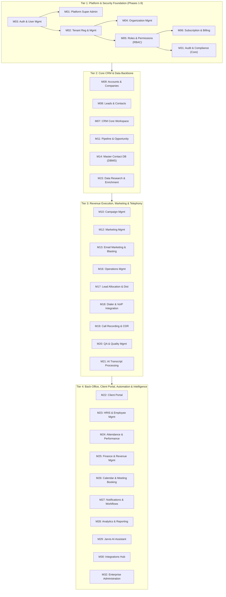

# Module Dependency Matrix (All 32 Platform Modules)

**Last Updated:** 2026-11-12  
**Status:** Phase 0 Master Dependency Blueprint  
**Version:** 0.1.0

---

## 1. Architectural Tiering Diagram

---

## 2. Complete 32-Module Dependency Matrix

| ID | Module Name | Target Phase / Wave | Hard Upstream Dependencies (Must Exist First) | Downstream Consumers | External Infra / Services Required |
|---|---|---|---|---|---|
| **M01** | Platform Super Admin | Phase 3–8 | M03, M31 (Core) | M02, M06, M32 | PostgreSQL, Redis |
| **M02** | Tenant Registration & Management | Phase 4 | M01, M03 | All Tenant Modules (M04–M32) | PostgreSQL RLS, Transactional Email |
| **M03** | Authentication & User Management | Phase 3 | DB Foundation (Phase 2) | All Modules (M01–M32) | PostgreSQL, Redis, SMTP |
| **M04** | Organization Management | Phase 4–8 | M02, M03, M05 | M16, M23, M28, M32 | PostgreSQL, S3 (Logos) |
| **M05** | Roles & Permissions | Phase 5 | M02, M03 | All Modules (Guard Enforcement) | PostgreSQL, Redis Permission Cache |
| **M06** | Subscription & Billing | Phase 7 | M01, M02, M05 | Quota enforcement in M08, M13, M14, M18 | Payment Gateway (Stripe/Razorpay) |
| **M07** | CRM | Wave 1 (Post-Phase 9) | M04, M05, M08, M09 | M11, M26, M27, M28, M29 | PostgreSQL, Redis |
| **M08** | Leads & Contacts | Wave 1 | M04, M05, M09 | M07, M10, M11, M13, M17, M18 | PostgreSQL (`pg_trgm`), S3 (Imports) |
| **M09** | Accounts & Companies | Wave 1 | M04, M05 | M07, M08, M11, M22, M25 | PostgreSQL |
| **M10** | Campaign Management | Wave 2 | M07, M08, M09 | M12, M13, M16, M17, M20, M22, M28 | PostgreSQL, BullMQ |
| **M11** | Pipeline & Opportunity Management | Wave 1 | M07, M08, M09 | M25, M26, M28, M29 | PostgreSQL |
| **M12** | Marketing Management | Wave 2 | M08, M10 | M13, M28 | PostgreSQL, S3 (Assets) |
| **M13** | Email Marketing & Email Blasting | Wave 2 | M06, M08, M10, M12, M27 | M28 | BullMQ, SES/SendGrid/Postal + Webhooks |
| **M14** | Master Contact Database / DBMS | Wave 2 | M05, M06, M09 | M08, M10, M15, M17 | PostgreSQL Partitioning/GIN, S3, BullMQ |
| **M15** | Data Research & Enrichment | Wave 2 | M14, M08, M09 | M10, M17 | BullMQ, Optional Enrichment APIs |
| **M16** | Operations Management | Wave 3 | M04, M05, M10 | M17, M20, M22, M24, M28 | PostgreSQL, Redis |
| **M17** | Lead Allocation & Distribution | Wave 3 | M08, M10, M14, M16 | M18, M27, M28 | BullMQ, Redis Locks |
| **M18** | Dialer & VoIP Integration | Wave 3 | M06, M08, M17, M30 | M19, M20, M28 | WebRTC / Twilio / SIP / Exotel / Asterisk |
| **M19** | Call Recording & CDR | Wave 3 | M18 | M20, M21, M22, M28, M31 | S3 Object Storage, Webhook Workers |
| **M20** | QA & Quality Management | Wave 3 | M10, M16, M19 | M22, M24, M28 | PostgreSQL, S3 Audio Streaming |
| **M21** | AI Transcript Processing | Wave 4 | M19, M20 | M28, M29 | BullMQ, STT + LLM APIs |
| **M22** | Client Portal | Wave 4 | M03, M05, M09, M10, M16, M20 | M25, M28 | Dedicated Portal Guard & Scoped RLS |
| **M23** | HRIS & Employee Management | Wave 4 | M03, M04, M05 | M16, M24, M25 | PostgreSQL, S3 (Encrypted HR Docs) |
| **M24** | Attendance & Performance Mgmt | Wave 4 | M16, M20, M23 | M25, M28 | PostgreSQL, BullMQ Cron |
| **M25** | Finance & Revenue Management | Wave 4 | M06, M09, M11, M22, M23 | M28, M31 | PostgreSQL (`NUMERIC`), PDF Worker |
| **M26** | Calendar & Meeting Booking | Wave 2 / 4 | M03, M07, M08, M11 | M27, M30 | PostgreSQL (`btree_gist`), OAuth (GCal/M365) |
| **M27** | Notifications & Workflow Automation | Foundation Core + Wave 2 | M03, M05 (Core in Phase 8; Builder in Wave 2) | All Domain Modules | BullMQ, Redis Pub/Sub, WebSockets, SMTP |
| **M28** | Analytics & Reporting | Wave 5 (Incremental per wave) | M07–M25 | Dashboards across all 9 personas | Read-Optimized SQL / Materialized Views |
| **M29** | Jarvis AI Assistant | Wave 5 | M05, M07, M11, M21, M28 | Tenant Workspace Personas | LLM API + Strict RBAC/RLS Tool Sandbox |
| **M30** | Integrations | Wave 5 | M04, M05, M27, M31 | M13, M18, M26 | Encrypted Credential Vault, Webhook Engine |
| **M31** | Audit & Compliance | Phase 6 (Core) + Wave 5 (Compliance) | M02, M03, M05 | M01, M32, Security Reviews | Append-Only Partitioned PostgreSQL + S3 Cold Archive |
| **M32** | Enterprise Administration | Wave 5 | M01, M04, M05, M06, M31 | Large Enterprise Tenants | SAML/OIDC SSO, SCIM, IP Allowlists, Custom Domains |

