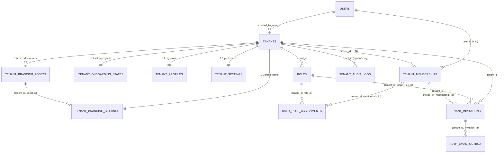

# FunnelTrack360 — Phase 4 Database Design Specification

**Phase:** Phase 4 — Tenant Onboarding & Management  
**Target Engine:** PostgreSQL 18 (Native `pg` Driver — **Zero ORM**)  
**Existing Migrations Preserved Untouched:** `0001` through `0006` (`15` public tables)  
**Planned Forward Migration Sequence (During Approved Implementation Only):** `0007` (Profile, Onboarding, Settings, Branding, Permissions & Domain Audit), `0008` (Invitations, Outbox Extension, Lifecycle, Session Eviction & Serialized Anti-Lockout Routines)  
**Resulting Schema Footprint:** `22` `FORCE RLS` public tables (`15` existing + `7` new), `24` canonical permissions (`14` existing + `10` new)  
**Document Status:** `PLANNING BASELINE — PRODUCT & TECHNICAL DECISIONS CONFIRMED (NO MIGRATIONS WRITTEN)`  
**Last Updated:** 2026-11-14

---

## 1. Live Inspection & Evaluation of Existing Tables (`0001`–`0006`)

All `15` existing tables and their triggers, grants, and RLS policies were inspected directly in `db/migrations/0001..0006` before proposing changes:

| Existing Table | Evaluation Decision | Planned Forward `ALTER` Changes (`0007`–`0008`) | Live SQL Compatibility Rationale |
|---|---|---|---|
| **`public.tenants`** (`0003`) | **Retain & Minimally Extend** | 1. Expand `chk_tenants_status` to `('PROVISIONING', 'TRIAL', 'ACTIVE', 'SUSPENDED', 'DEACTIVATED', 'CANCELLED')`. 2. Add `deactivated_at TIMESTAMPTZ NULL`, `cancelled_at TIMESTAMPTZ NULL`, `status_reason VARCHAR(500) NULL`, `onboarding_completed_at TIMESTAMPTZ NULL`, `created_by_user_id UUID NULL REFERENCES public.users(id) ON DELETE SET NULL`. 3. Extend `trigger_protect_tenant_lifecycle()` to also guard `deactivated_at`, `cancelled_at`, `status_reason`, and `created_by_user_id`, AND reject any update where `OLD.status = 'CANCELLED'`. | Preserves `tenants_insert_platform` RLS (`0003` line 357) unweakened while supporting `DEACTIVATED`, terminal `CANCELLED` immutability, and per-user creation quota tracking (`created_by_user_id`). |
| **`public.tenant_memberships`** (`0003`) | **Retain & Minimally Extend** | 1. Add `is_primary_owner BOOLEAN NOT NULL DEFAULT FALSE`. 2. Add `suspended_at TIMESTAMPTZ NULL`, `revoked_at TIMESTAMPTZ NULL`, `status_reason VARCHAR(500) NULL`. 3. Add `chk_tm_primary_owner_internal_active CHECK (NOT is_primary_owner OR (membership_type = 'INTERNAL' AND status = 'ACTIVE'))`. 4. Add partial unique index `uq_tenant_memberships_primary_owner ON (tenant_id) WHERE is_primary_owner = TRUE AND status = 'ACTIVE'`. | Reuses existing `(tenant_id, user_id)` uniqueness (`uq_tenant_memberships_tenant_user`) and `(tenant_id, id)` composite FK anchor (`uq_tenant_memberships_tenant_id_id`). |
| **`public.permissions`** (`0004` / `0005`) | **Retain & Seed `10` Canonical `TENANT` Codes** | `INSERT ... ON CONFLICT (code) DO NOTHING` (all matching `chk_permissions_code_format` `^[a-z0-9_]+:[a-z0-9_]+:[a-z0-9_]+$`): • `tenant:settings:read` (`TENANT`, `M04`) • `tenant:settings:manage` (`TENANT`, `M04`) • `tenant:branding:read` (`TENANT`, `M04`) • `tenant:branding:manage` (`TENANT`, `M04`) • `tenant:roles:assign` (`TENANT`, `M05`) • `tenant:invitations:read` (`TENANT`, `M04`) • `tenant:invitations:manage` (`TENANT`, `M04`) • `tenant:admins:read` (`TENANT`, `M04`) • `tenant:admins:manage` (`TENANT`, `M04`) • `audit:tenant:read` (`TENANT`, `M31`) | Ensures every Phase 4 endpoint maps 1-to-1 to an explicit permission without implicit guard fallbacks, while `trigger_enforce_tenant_permission_scope()` continues blocking `PLATFORM` codes on tenant roles. |
| **`public.auth_email_outbox`** (`0006`) | **Retain & Extend with Strict Initiator vs. Recipient Separation** | 1. `ALTER COLUMN user_id DROP NOT NULL` (brand-new invitees do not yet have a `public.users` row, and `user_id` strictly represents a **recipient** auth user—never the initiating admin). 2. Add `initiated_by_user_id UUID NULL REFERENCES public.users(id) ON DELETE SET NULL`, `tenant_id UUID NULL`, and `invitation_id UUID NULL` with composite FK `fk_auth_email_outbox_invitation FOREIGN KEY (tenant_id, invitation_id) REFERENCES public.tenant_invitations(tenant_id, id) ON DELETE CASCADE`. 3. Expand `chk_auth_email_outbox_kind` (column `kind`, verified in `0006` line 159) to `('EMAIL_VERIFICATION', 'PASSWORD_RESET', 'TENANT_INVITATION')`. 4. Add `chk_auth_email_outbox_anchor CHECK ((kind IN ('EMAIL_VERIFICATION', 'PASSWORD_RESET') AND user_id IS NOT NULL AND initiated_by_user_id IS NULL AND tenant_id IS NULL AND invitation_id IS NULL) OR (kind = 'TENANT_INVITATION' AND user_id IS NULL AND tenant_id IS NOT NULL AND invitation_id IS NOT NULL))`. 5. Grant `SELECT (initiated_by_user_id, tenant_id, invitation_id)` to `ft360_app` (`encrypted_action_token` remains ungranted). | Prevents conflating the **user initiating the invitation** (`initiated_by_user_id`) with the **invitation recipient** (`recipient_email`, `user_id IS NULL`) while preserving Phase 3 verification/reset invariants untouched. |
| **`public.users`** (`0003`) | **Preserve RLS (`users_select`) + Harden Canonical Email Uniqueness** | 1. `users_select` policy (`0003` line 264) kept 100% untouched. 2. Reinforce existing `CONSTRAINT uq_users_email UNIQUE (email)` (`CITEXT`) with `chk_users_email_canonical_trimmed CHECK (email::text = lower(btrim(email::text)))` and functional unique index `CREATE UNIQUE INDEX uq_users_email_normalized ON public.users (lower(btrim(email::text)))`. | Guarantees hard PostgreSQL `SQLSTATE 23505` (`unique_violation`) rejection against duplicate global email registration under concurrent `accept-register` and `/auth/register` races across any case/whitespace variants, while `fn_tenant_list_workspace_members` handles admin-only `SUSPENDED`/`REVOKED` reads without weakening `users_select`. |
| **`public.auth_sessions`** (`0005` / `0006`) | **Zero Table/Grant Changes + PG Lifecycle Check in `fn_auth_validate_session`** | `ft360_app` column grants kept 100% untouched; update `fn_auth_validate_session` (`LEFT JOIN public.tenants t ON t.id = s.active_tenant_id`) so non-operational tenants (`status NOT IN ('ACTIVE', 'TRIAL')`) are detected directly in PostgreSQL even if Redis is offline. | Existing index `idx_auth_sessions_active_tenant_member (active_tenant_id, active_membership_id)` (`0005` line 89) accelerates `O(log N)` session unbinding inside `fn_platform_transition_tenant_status` and `fn_tenant_evict_member_sessions`. |
| **`roles`, `role_permissions`, `user_role_assignments`, `auth_audit_logs`** | **Retain + Add Admin Triggers** | Attach `trigger_enforce_admin_membership_type()` and serialized `trigger_prevent_last_tenant_admin_removal()` on `user_role_assignments` and `tenant_memberships`. | Preserves all Phase 2–3 composite FKs, RLS policies, and `fn_jsonb_has_forbidden_secret_key` (`0006` line 743). |

---

## 2. Phase 4 Entity-Relationship Diagram

---

## 3. Proposed New Tables (`7` Tables)

> **Universal Invariants Across All `7` Tables:**
> - **Owner:** `ft360_migrator` (`ft360_app` owns `0` tables).
> - **Row-Level Security:** `ENABLE ROW LEVEL SECURITY` + `FORCE ROW LEVEL SECURITY` + `migrator_all_*` policy for `ft360_migrator`.
> - **Fail-Closed Context & PostgreSQL Lifecycle Gate:** Tenant policies strictly evaluate `tenant_id = public.app_current_tenant_id()` (`NULL` or empty GUC fails closed with `0` rows / `42501`), and tenant-plane `INSERT`/`UPDATE`/`DELETE` policies on operational domain tables additionally enforce `public.fn_is_current_tenant_operational()` (`EXISTS (SELECT 1 FROM public.tenants t WHERE t.id = public.app_current_tenant_id() AND t.status IN ('ACTIVE', 'TRIAL'))`), guaranteeing PostgreSQL blocks writes to `PROVISIONING`, `SUSPENDED`, `DEACTIVATED`, and `CANCELLED` tenants even when Redis is completely unavailable.
> - **Primary Keys:** `uuidv7()` on multi-row tables; `tenant_id UUID PRIMARY KEY` on `1:1` tenant extension tables.

---

### 3.1 `public.tenant_onboarding_states`
- **Purpose:** Tracks resumable 4-step onboarding progress and completion metadata (`Module 4.2`).
- **Tenant Ownership:** Strict `1:1` tenant-owned record (`tenant_id` PK & FK).
- **Columns & PostgreSQL Types:**
  | Column | Type | Null | Default | Notes |
  |---|---|---|---|---|
  | `tenant_id` | `UUID` | `NOT NULL` | — | PK & FK -> `tenants(id)` |
  | `onboarding_status` | `VARCHAR(24)` | `NOT NULL` | `'IN_PROGRESS'` | `'IN_PROGRESS'`, `'COMPLETED'` |
  | `current_step` | `VARCHAR(32)` | `NOT NULL` | `'ORG_PROFILE'` | Active wizard step |
  | `org_profile_completed_at` | `TIMESTAMPTZ` | `NULL` | `NULL` | Required step 1 |
  | `org_settings_completed_at` | `TIMESTAMPTZ` | `NULL` | `NULL` | Required step 2 |
  | `org_branding_completed_at` | `TIMESTAMPTZ` | `NULL` | `NULL` | Optional step 3 |
  | `org_branding_skipped` | `BOOLEAN` | `NOT NULL` | `FALSE` | Explicit skip flag |
  | `team_invites_completed_at` | `TIMESTAMPTZ` | `NULL` | `NULL` | Optional step 4 |
  | `team_invites_skipped` | `BOOLEAN` | `NOT NULL` | `FALSE` | Explicit skip flag |
  | `completed_at` | `TIMESTAMPTZ` | `NULL` | `NULL` | Set when finalized |
  | `completed_by_membership_id` | `UUID` | `NULL` | `NULL` | Composite FK |
  | `version` | `INTEGER` | `NOT NULL` | `1` | Optimistic lock counter |
  | `created_at` | `TIMESTAMPTZ` | `NOT NULL` | `NOW()` | Immutable |
  | `updated_at` | `TIMESTAMPTZ` | `NOT NULL` | `NOW()` | Trigger `trigger_set_updated_at()` |
- **Primary Key:** `pk_tenant_onboarding_states PRIMARY KEY (tenant_id)`
- **Foreign Keys:**
  - `fk_tos_tenant`: `FOREIGN KEY (tenant_id) REFERENCES public.tenants(id) ON DELETE CASCADE`
  - `fk_tos_completed_by_membership`: `FOREIGN KEY (tenant_id, completed_by_membership_id) REFERENCES public.tenant_memberships(tenant_id, id) ON DELETE SET NULL (completed_by_membership_id)`
- **Unique Constraints:** `1:1` via `PRIMARY KEY (tenant_id)`.
- **Check Constraints:**
  - `chk_tos_status`: `onboarding_status IN ('IN_PROGRESS', 'COMPLETED')`
  - `chk_tos_step`: `current_step IN ('ORG_PROFILE', 'ORG_SETTINGS', 'ORG_BRANDING', 'TEAM_INVITES', 'REVIEW_COMPLETE')`
  - `chk_tos_completion_integrity`: `(onboarding_status = 'IN_PROGRESS' AND completed_at IS NULL) OR (onboarding_status = 'COMPLETED' AND completed_at IS NOT NULL AND org_profile_completed_at IS NOT NULL AND org_settings_completed_at IS NOT NULL)`
  - `chk_tos_version_positive`: `version >= 1`
- **Indexes:** `idx_tos_incomplete ON public.tenant_onboarding_states (onboarding_status, created_at DESC) WHERE onboarding_status = 'IN_PROGRESS'`
- **RLS Requirements:** `ENABLE` + `FORCE RLS`. `SELECT`/`INSERT`/`UPDATE` for `ft360_app`: `tenant_id = app_current_tenant_id() OR app_is_super_admin()`. `GRANT SELECT, INSERT, UPDATE ON tenant_onboarding_states TO ft360_app`.
- **Audit Requirements:** Writes `TENANT_ONBOARDING_STEP_SAVED` and `TENANT_ONBOARDING_COMPLETED` to `tenant_audit_logs`.
- **Relationships:** `1:1` with `tenants`; composite FK to `tenant_memberships`.

---

### 3.2 `public.tenant_profiles`
- **Purpose:** Stores structured legal, industry, headquarters address, and contact metadata (`Module 4.3`).
- **Tenant Ownership:** Strict `1:1` tenant-owned record (`tenant_id` PK).
- **Columns & PostgreSQL Types:**
  | Column | Type | Null | Default | Notes |
  |---|---|---|---|---|
  | `tenant_id` | `UUID` | `NOT NULL` | — | PK & FK -> `tenants(id)` |
  | `organization_type` | `VARCHAR(32)` | `NOT NULL` | `'COMPANY'` | Enum check |
  | `industry` | `VARCHAR(48)` | `NOT NULL` | `'OTHER'` | Enum check |
  | `company_size_band` | `VARCHAR(24)` | `NULL` | `NULL` | `'1_10'`, `'11_50'`, `'51_200'`, `'201_1000'`, `'1000_PLUS'` |
  | `registration_number` | `VARCHAR(80)` | `NULL` | `NULL` | Corporate registration ID |
  | `tax_id` | `VARCHAR(80)` | `NULL` | `NULL` | Tax / VAT / GSTIN / EIN |
  | `website_url` | `VARCHAR(512)` | `NULL` | `NULL` | `^https?://` check |
  | `primary_contact_name` | `VARCHAR(160)` | `NULL` | `NULL` | Business contact |
  | `primary_contact_email` | `CITEXT` | `NULL` | `NULL` | Email format check |
  | `primary_contact_phone_e164` | `VARCHAR(24)` | `NULL` | `NULL` | E.164 format check |
  | `support_email` | `CITEXT` | `NULL` | `NULL` | Support email |
  | `address_line1` | `VARCHAR(200)` | `NULL` | `NULL` | Street line 1 |
  | `address_line2` | `VARCHAR(200)` | `NULL` | `NULL` | Suite / floor |
  | `city` | `VARCHAR(120)` | `NULL` | `NULL` | City |
  | `state_province` | `VARCHAR(120)` | `NULL` | `NULL` | State / province |
  | `postal_code` | `VARCHAR(32)` | `NULL` | `NULL` | Postal / ZIP |
  | `country_code` | `CHAR(2)` | `NOT NULL` | `'US'` | ISO 3166-1 alpha-2 |
  | `about_description` | `VARCHAR(1000)` | `NULL` | `NULL` | Organization summary |
  | `updated_by_membership_id` | `UUID` | `NULL` | `NULL` | Composite FK |
  | `version` | `INTEGER` | `NOT NULL` | `1` | Optimistic lock counter |
  | `created_at` | `TIMESTAMPTZ` | `NOT NULL` | `NOW()` | Immutable |
  | `updated_at` | `TIMESTAMPTZ` | `NOT NULL` | `NOW()` | Trigger `trigger_set_updated_at()` |
- **Primary Key:** `pk_tenant_profiles PRIMARY KEY (tenant_id)`
- **Foreign Keys:**
  - `fk_tenant_profiles_tenant`: `FOREIGN KEY (tenant_id) REFERENCES public.tenants(id) ON DELETE CASCADE`
  - `fk_tenant_profiles_updated_by`: `FOREIGN KEY (tenant_id, updated_by_membership_id) REFERENCES public.tenant_memberships(tenant_id, id) ON DELETE SET NULL (updated_by_membership_id)`
- **Unique Constraints:** `1:1` via `PRIMARY KEY (tenant_id)`.
- **Check Constraints:** `chk_tp_org_type`, `chk_tp_industry`, `chk_tp_size_band`, `chk_tp_website_url`, `chk_tp_emails`, `chk_tp_phone_e164`, `chk_tp_country_iso2` (`^[A-Z]{2}$`), `chk_tp_version_positive` (`version >= 1`).
- **Indexes:** `idx_tp_industry_country ON public.tenant_profiles (industry, country_code)`
- **RLS Requirements:** `ENABLE` + `FORCE RLS`. `SELECT`/`INSERT`/`UPDATE` for `ft360_app`: `tenant_id = app_current_tenant_id() OR app_is_super_admin()`. `GRANT SELECT, INSERT, UPDATE ON tenant_profiles TO ft360_app`.
- **Audit Requirements:** Writes `TENANT_PROFILE_UPDATED` with `before_state` / `after_state` field diffs to `tenant_audit_logs`.
- **Relationships:** `1:1` with `tenants` (syncs `display_name` & `legal_name`).

---

### 3.3 `public.tenant_settings`
- **Purpose:** Stores organization-wide regional, calendar, invitation expiry, and directory privacy settings (`Module 4.8`).
- **Tenant Ownership:** Strict `1:1` tenant-owned record (`tenant_id` PK).
- **Columns & PostgreSQL Types:**
  | Column | Type | Null | Default | Notes |
  |---|---|---|---|---|
  | `tenant_id` | `UUID` | `NOT NULL` | — | PK & FK -> `tenants(id)` |
  | `timezone` | `VARCHAR(64)` | `NOT NULL` | `'UTC'` | Synced to `tenants.default_timezone` |
  | `locale` | `VARCHAR(16)` | `NOT NULL` | `'en-US'` | BCP-47 tag |
  | `date_format` | `VARCHAR(24)` | `NOT NULL` | `'YYYY-MM-DD'` | Allowed formats check |
  | `time_format` | `VARCHAR(8)` | `NOT NULL` | `'24H'` | `'12H'` or `'24H'` |
  | `default_currency` | `CHAR(3)` | `NOT NULL` | `'USD'` | Synced to `tenants.default_currency` |
  | `week_start_day` | `SMALLINT` | `NOT NULL` | `1` | `0` (Sun) .. `6` (Sat) |
  | `fiscal_year_start_month` | `SMALLINT` | `NOT NULL` | `1` | `1` (Jan) .. `12` (Dec) |
  | `invitation_expiry_hours` | `INTEGER` | `NOT NULL` | `168` | `1` .. `720` (Confirmed `D3`) |
  | `allow_member_directory_view` | `BOOLEAN` | `NOT NULL` | **`FALSE`** | **Restricted by default for ordinary members (Confirmed `D4`)** |
  | `updated_by_membership_id` | `UUID` | `NULL` | `NULL` | Composite FK |
  | `version` | `INTEGER` | `NOT NULL` | `1` | Optimistic lock counter |
  | `created_at` | `TIMESTAMPTZ` | `NOT NULL` | `NOW()` | Immutable |
  | `updated_at` | `TIMESTAMPTZ` | `NOT NULL` | `NOW()` | Trigger `trigger_set_updated_at()` |
- **Primary Key:** `pk_tenant_settings PRIMARY KEY (tenant_id)`
- **Foreign Keys:**
  - `fk_tenant_settings_tenant`: `FOREIGN KEY (tenant_id) REFERENCES public.tenants(id) ON DELETE CASCADE`
  - `fk_tenant_settings_updated_by`: `FOREIGN KEY (tenant_id, updated_by_membership_id) REFERENCES public.tenant_memberships(tenant_id, id) ON DELETE SET NULL (updated_by_membership_id)`
- **Unique Constraints:** `1:1` via `PRIMARY KEY (tenant_id)`.
- **Check Constraints:** `chk_ts_locale`, `chk_ts_date_format`, `chk_ts_time_format`, `chk_ts_currency_iso`, `chk_ts_week_start` (`0..6`), `chk_ts_fiscal_month` (`1..12`), `chk_ts_invite_expiry` (`1..720`), `chk_ts_version_positive` (`version >= 1`).
- **Indexes:** Primary key B-tree (`tenant_id`).
- **RLS Requirements:** `ENABLE` + `FORCE RLS`. `SELECT`/`INSERT`/`UPDATE` for `ft360_app`: `tenant_id = app_current_tenant_id() OR app_is_super_admin()`. `GRANT SELECT, INSERT, UPDATE ON tenant_settings TO ft360_app`.
- **Audit Requirements:** Writes `TENANT_SETTINGS_UPDATED` to `tenant_audit_logs` and invalidates `t:{tenantId}:settings:active`.
- **Relationships:** `1:1` with `tenants`.

---

### 3.4 `public.tenant_branding_assets`
- **Purpose:** Tracks fully decoded, metadata-stripped tenant raster branding assets (`LOGO_LIGHT`, `LOGO_DARK`, `FAVICON`) stored under isolated `tenants/{tenantId}/branding/...` keys (`Module 4.9`).
- **Tenant Ownership:** Multi-row tenant-owned table (`tenant_id NOT NULL`) with composite anchor `(tenant_id, id)`.
- **Columns & PostgreSQL Types:**
  | Column | Type | Null | Default | Notes |
  |---|---|---|---|---|
  | `id` | `UUID` | `NOT NULL` | `uuidv7()` | PK |
  | `tenant_id` | `UUID` | `NOT NULL` | — | FK -> `tenants(id)` |
  | `asset_kind` | `VARCHAR(24)` | `NOT NULL` | — | `'LOGO_LIGHT'`, `'LOGO_DARK'`, `'FAVICON'` |
  | `storage_key` | `VARCHAR(512)` | `NOT NULL` | — | Server-generated isolated key |
  | `original_filename` | `VARCHAR(255)` | `NOT NULL` | — | Sanitized display basename only |
  | `mime_type` | `VARCHAR(64)` | `NOT NULL` | — | `'image/png'`, `'image/jpeg'`, `'image/webp'` |
  | `byte_size` | `INTEGER` | `NOT NULL` | — | Sanitized re-encoded size (`<= 2 MiB` / `<= 256 KiB`) |
  | `sha256_checksum` | `CHAR(64)` | `NOT NULL` | — | Checksum of sanitized output buffer |
  | `width_px` | `INTEGER` | `NOT NULL` | — | Verified decoded width |
  | `height_px` | `INTEGER` | `NOT NULL` | — | Verified decoded height |
  | `metadata_stripped` | `BOOLEAN` | `NOT NULL` | `TRUE` | Enforces EXIF/XMP/chunk sanitization |
  | `status` | `VARCHAR(24)` | `NOT NULL` | `'ACTIVE'` | `'ACTIVE'`, `'SUPERSEDED'`, `'DELETED'` |
  | `uploaded_by_membership_id` | `UUID` | `NULL` | `NULL` | Composite FK |
  | `created_at` | `TIMESTAMPTZ` | `NOT NULL` | `NOW()` | Immutable |
  | `updated_at` | `TIMESTAMPTZ` | `NOT NULL` | `NOW()` | Trigger `trigger_set_updated_at()` |
- **Primary Key:** `pk_tenant_branding_assets PRIMARY KEY (id)`
- **Foreign Keys:**
  - `fk_tba_tenant`: `FOREIGN KEY (tenant_id) REFERENCES public.tenants(id) ON DELETE CASCADE`
  - `fk_tba_uploaded_by`: `FOREIGN KEY (tenant_id, uploaded_by_membership_id) REFERENCES public.tenant_memberships(tenant_id, id) ON DELETE SET NULL (uploaded_by_membership_id)`
- **Unique Constraints:**
  - `uq_tba_tenant_id_id`: `UNIQUE (tenant_id, id)`
  - `uq_tba_storage_key`: `UNIQUE (storage_key)`
- **Check Constraints:**
  - `chk_tba_kind`: `asset_kind IN ('LOGO_LIGHT', 'LOGO_DARK', 'FAVICON')`
  - `chk_tba_mime_allowlist`: `(asset_kind IN ('LOGO_LIGHT', 'LOGO_DARK') AND mime_type IN ('image/png', 'image/jpeg', 'image/webp')) OR (asset_kind = 'FAVICON' AND mime_type IN ('image/png', 'image/webp'))` *(SVG unconditionally prohibited)*
  - `chk_tba_size_bounds`: `(asset_kind = 'FAVICON' AND byte_size BETWEEN 1 AND 262144) OR (asset_kind IN ('LOGO_LIGHT', 'LOGO_DARK') AND byte_size BETWEEN 1 AND 2097152)`
  - `chk_tba_dimension_and_pixel_bounds`: `(asset_kind IN ('LOGO_LIGHT', 'LOGO_DARK') AND width_px BETWEEN 16 AND 2048 AND height_px BETWEEN 16 AND 2048 AND (width_px * height_px) <= 4194304) OR (asset_kind = 'FAVICON' AND width_px BETWEEN 16 AND 512 AND height_px = width_px AND (width_px * height_px) <= 262144)`
  - `chk_tba_metadata_stripped`: `metadata_stripped = TRUE`
  - `chk_tba_storage_prefix`: `storage_key LIKE ('tenants/' || tenant_id::text || '/branding/%') AND storage_key !~ '\.\.'`
  - `chk_tba_sha256_hex`: `sha256_checksum ~ '^[0-9a-f]{64}$'`
  - `chk_tba_status`: `status IN ('ACTIVE', 'SUPERSEDED', 'DELETED')`
- **Indexes:** `idx_tba_tenant_kind_status ON public.tenant_branding_assets (tenant_id, asset_kind, status)`
- **RLS Requirements:** `ENABLE` + `FORCE RLS`. `SELECT`/`INSERT`/`UPDATE` for `ft360_app`: `tenant_id = app_current_tenant_id() OR app_is_super_admin()`. `GRANT SELECT, INSERT, UPDATE ON tenant_branding_assets TO ft360_app`.
- **Audit Requirements:** Writes `TENANT_BRANDING_ASSET_UPLOADED` and `TENANT_BRANDING_ASSET_REMOVED` to `tenant_audit_logs`.
- **Relationships:** Referenced via composite FKs `(tenant_id, *_asset_id)` from `tenant_branding_settings`.

---

### 3.5 `public.tenant_branding_settings`
- **Purpose:** Stores active white-label branding configuration per organization (`Module 4.9`).
- **Tenant Ownership:** Strict `1:1` tenant-owned record (`tenant_id` PK).
- **Columns & PostgreSQL Types:**
  | Column | Type | Null | Default | Notes |
  |---|---|---|---|---|
  | `tenant_id` | `UUID` | `NOT NULL` | — | PK & FK -> `tenants(id)` |
  | `brand_display_name` | `VARCHAR(120)` | `NULL` | `NULL` | Overrides workspace header title |
  | `tagline` | `VARCHAR(255)` | `NULL` | `NULL` | Optional workspace subtitle |
  | `primary_color_hex` | `CHAR(7)` | `NOT NULL` | `'#2563EB'` | `^#[0-9A-Fa-f]{6}$` |
  | `accent_color_hex` | `CHAR(7)` | `NOT NULL` | `'#0F172A'` | `^#[0-9A-Fa-f]{6}$` |
  | `theme_mode` | `VARCHAR(16)` | `NOT NULL` | `'LIGHT'` | `'LIGHT'`, `'DARK'`, `'SYSTEM'` |
  | `logo_light_asset_id` | `UUID` | `NULL` | `NULL` | Composite FK -> `tenant_branding_assets` |
  | `logo_dark_asset_id` | `UUID` | `NULL` | `NULL` | Composite FK -> `tenant_branding_assets` |
  | `favicon_asset_id` | `UUID` | `NULL` | `NULL` | Composite FK -> `tenant_branding_assets` |
  | `support_email` | `CITEXT` | `NULL` | `NULL` | Branded help email |
  | `support_url` | `VARCHAR(512)` | `NULL` | `NULL` | `^https?://` |
  | `email_footer_text` | `VARCHAR(300)` | `NULL` | `NULL` | Branded invite footer |
  | `updated_by_membership_id` | `UUID` | `NULL` | `NULL` | Composite FK |
  | `version` | `INTEGER` | `NOT NULL` | `1` | Optimistic lock counter |
  | `created_at` | `TIMESTAMPTZ` | `NOT NULL` | `NOW()` | Immutable |
  | `updated_at` | `TIMESTAMPTZ` | `NOT NULL` | `NOW()` | Trigger `trigger_set_updated_at()` |
- **Primary Key:** `pk_tenant_branding_settings PRIMARY KEY (tenant_id)`
- **Foreign Keys:** `fk_tbs_tenant`, plus composite FKs `fk_tbs_logo_light`, `fk_tbs_logo_dark`, `fk_tbs_favicon` (`REFERENCES tenant_branding_assets(tenant_id, id) ON DELETE SET NULL`) and `fk_tbs_updated_by` (`REFERENCES tenant_memberships(tenant_id, id) ON DELETE SET NULL`).
- **Unique Constraints:** `1:1` via `PRIMARY KEY (tenant_id)`.
- **Check Constraints:** `chk_tbs_primary_hex`, `chk_tbs_accent_hex`, `chk_tbs_theme_mode`, `chk_tbs_support_url`, `chk_tbs_version_positive`.
- **Indexes:** Primary key (`tenant_id`).
- **RLS Requirements:** `ENABLE` + `FORCE RLS`. `SELECT`/`INSERT`/`UPDATE` for `ft360_app`: `tenant_id = app_current_tenant_id() OR app_is_super_admin()`. `GRANT SELECT, INSERT, UPDATE ON tenant_branding_settings TO ft360_app`.
- **Audit Requirements:** Writes `TENANT_BRANDING_UPDATED` to `tenant_audit_logs` and invalidates `t:{tenantId}:branding:resolved`.
- **Relationships:** `1:1` with `tenants`; composite FKs prevent cross-tenant asset binding (`23503`).

---

### 3.6 `public.tenant_invitations`
- **Purpose:** Manages cryptographic single-use email invitations, expiration, resend rotation, revocation, and atomic dual-path acceptance (`Module 4.6`).
- **Tenant Ownership:** Multi-row tenant-owned table (`tenant_id NOT NULL`).
- **Columns & PostgreSQL Types:**
  | Column | Type | Null | Default | Notes |
  |---|---|---|---|---|
  | `id` | `UUID` | `NOT NULL` | `uuidv7()` | PK |
  | `tenant_id` | `UUID` | `NOT NULL` | — | FK -> `tenants(id)` |
  | `invited_email` | `CITEXT` | `NOT NULL` | — | Case-insensitive target email |
  | `membership_type` | `VARCHAR(24)` | `NOT NULL` | `'INTERNAL'` | `'INTERNAL'`, `'CLIENT_PORTAL'`, `'PARTNER'` |
  | `target_role_id` | `UUID` | `NOT NULL` | — | Composite FK -> `roles(tenant_id, id)` |
  | `job_title` | `VARCHAR(120)` | `NULL` | `NULL` | Applied on acceptance |
  | `token_hash` | `CHAR(64)` | `NOT NULL` | — | SHA-256 hex; **omitted from `ft360_app` `SELECT`!** |
  | `status` | `VARCHAR(24)` | `NOT NULL` | `'PENDING'` | `'PENDING'`, `'ACCEPTED'`, `'EXPIRED'`, `'REVOKED'` |
  | `expires_at` | `TIMESTAMPTZ` | `NOT NULL` | — | `NOW() + invitation_expiry_hours` |
  | `resend_count` | `INTEGER` | `NOT NULL` | `0` | `0..10` |
  | `last_sent_at` | `TIMESTAMPTZ` | `NOT NULL` | `NOW()` | `60s` resend cooldown |
  | `invited_by_user_id` | `UUID` | `NULL` | `NULL` | **Initiator** FK -> `users(id)` (derived from `app_current_user_id()`) |
  | `invited_by_membership_id` | `UUID` | `NULL` | `NULL` | **Initiator** composite FK -> `tenant_memberships` |
  | `accepted_at` | `TIMESTAMPTZ` | `NULL` | `NULL` | Single-use consumption timestamp |
  | `accepted_by_user_id` | `UUID` | `NULL` | `NULL` | **Recipient** FK -> `users(id)` (`NULL` until accepted) |
  | `accepted_membership_id` | `UUID` | `NULL` | `NULL` | **Recipient** composite FK -> `tenant_memberships` (`NULL` until accepted) |
  | `revoked_at` | `TIMESTAMPTZ` | `NULL` | `NULL` | Revocation timestamp |
  | `revoked_by_user_id` | `UUID` | `NULL` | `NULL` | FK -> `users(id)` |
  | `revoked_reason` | `VARCHAR(500)` | `NULL` | `NULL` | Optional/required reason |
  | `created_at` | `TIMESTAMPTZ` | `NOT NULL` | `NOW()` | Immutable |
  | `updated_at` | `TIMESTAMPTZ` | `NOT NULL` | `NOW()` | Trigger `trigger_set_updated_at()` |
- **Primary Key:** `pk_tenant_invitations PRIMARY KEY (id)`
- **Foreign Keys:** `fk_ti_tenant`, composite FKs `fk_ti_target_role` (`roles(tenant_id, id)`), `fk_ti_invited_by_membership` (`tenant_memberships(tenant_id, id)`), `fk_ti_accepted_membership` (`tenant_memberships(tenant_id, id)`), plus `fk_ti_invited_by_user`, `fk_ti_accepted_by_user`, `fk_ti_revoked_by_user`.
- **Unique Constraints & Partial Unique Indexes:**
  - `uq_ti_token_hash`: `UNIQUE (token_hash)`
  - `uq_ti_tenant_id_id`: `UNIQUE (tenant_id, id)` *(composite FK target for `auth_email_outbox`)*
  - `uq_ti_pending_tenant_email`: `CREATE UNIQUE INDEX uq_ti_pending_tenant_email ON public.tenant_invitations (tenant_id, invited_email) WHERE status = 'PENDING'`
- **Check Constraints (Including Initiator vs. Recipient Separation):** `chk_ti_email_format`, `chk_ti_email_canonical_trimmed` (`invited_email::text = lower(btrim(invited_email::text))`), `chk_ti_membership_type`, `chk_ti_status`, `chk_ti_token_hash_hex` (`^[0-9a-f]{64}$`), `chk_ti_resend_bounds` (`0..10`), `chk_ti_expiry_order` (`expires_at > created_at`), `chk_ti_pending_recipient_unbound` (`status <> 'PENDING' OR (accepted_by_user_id IS NULL AND accepted_membership_id IS NULL AND accepted_at IS NULL)`), `chk_ti_accepted_integrity` (`status <> 'ACCEPTED' OR (accepted_by_user_id IS NOT NULL AND accepted_membership_id IS NOT NULL AND accepted_at IS NOT NULL)`), and `chk_ti_initiator_recipient_distinct` (`accepted_by_user_id IS NULL OR invited_by_user_id IS NULL OR accepted_by_user_id <> invited_by_user_id`).
- **Indexes:** `idx_ti_tenant_status_created (tenant_id, status, created_at DESC)`, `idx_ti_invited_email (invited_email, status)`.
- **RLS & Column Grants:** `ENABLE` + `FORCE RLS`. `SELECT`: `tenant_id = app_current_tenant_id() OR app_is_super_admin()`. Column-level `GRANT SELECT` to `ft360_app` **omits `token_hash`** (`42501` if selected). All mutations execute through narrow `SECURITY DEFINER` routines.
- **Audit Requirements:** Writes `TENANT_INVITATION_CREATED`, `TENANT_INVITATION_RESENT`, `TENANT_INVITATION_REVOKED`, and `TENANT_INVITATION_ACCEPTED`.
- **Relationships:** Links `tenants`, `roles`, `users`, `tenant_memberships`, and `auth_email_outbox`.

---

### 3.7 `public.tenant_audit_logs`
- **Purpose:** Immutable, append-only tenant domain governance and field-diff ledger (`Module 4.10`).
- **Tenant Ownership:** Strict tenant-attributed table (`tenant_id UUID NOT NULL`).
- **Columns & PostgreSQL Types:**
  | Column | Type | Null | Default | Notes |
  |---|---|---|---|---|
  | `id` | `UUID` | `NOT NULL` | `uuidv7()` | PK |
  | `tenant_id` | `UUID` | `NOT NULL` | — | FK -> `tenants(id) ON DELETE RESTRICT` |
  | `event_type` | `VARCHAR(80)` | `NOT NULL` | — | Canonical uppercase code |
  | `resource_type` | `VARCHAR(48)` | `NOT NULL` | — | `'TENANT'`, `'ONBOARDING'`, `'PROFILE'`, `'SETTINGS'`, `'BRANDING'`, `'INVITATION'`, `'MEMBERSHIP'`, `'ROLE_ASSIGNMENT'` |
  | `resource_id` | `UUID` | `NULL` | `NULL` | Target entity UUID |
  | `outcome` | `VARCHAR(16)` | `NOT NULL` | `'SUCCESS'` | `'SUCCESS'`, `'FAILURE'`, `'DENIED'` |
  | `actor_plane` | `VARCHAR(24)` | `NOT NULL` | — | `'TENANT'`, `'PLATFORM'`, `'USER_ONBOARDING'` |
  | `actor_user_id` | `UUID` | `NULL` | `NULL` | FK -> `users(id) ON DELETE SET NULL` |
  | `actor_membership_id` | `UUID` | `NULL` | `NULL` | Composite FK -> `tenant_memberships` |
  | `reason` | `VARCHAR(500)` | `NULL` | `NULL` | Mandatory for lifecycle/suspend/revoke/transfer |
  | `before_state` | `JSONB` | `NULL` | `NULL` | Changed-field snapshot prior to mutation |
  | `after_state` | `JSONB` | `NULL` | `NULL` | Changed-field snapshot after mutation |
  | `metadata` | `JSONB` | `NOT NULL` | `'{}'::jsonb` | Contextual telemetry |
  | `correlation_id` | `UUID` | `NOT NULL` | — | End-to-end request/job trace ID |
  | `ip_address` | `INET` | `NULL` | `NULL` | Client IP |
  | `user_agent` | `VARCHAR(512)` | `NULL` | `NULL` | Client UA |
  | `created_at` | `TIMESTAMPTZ` | `NOT NULL` | `NOW()` | Immutable |
- **Primary Key:** `pk_tenant_audit_logs PRIMARY KEY (id)`
- **Foreign Keys:** `fk_tal_tenant` (`ON DELETE RESTRICT`), `fk_tal_actor_user` (`ON DELETE SET NULL`), composite `fk_tal_actor_membership` (`ON DELETE SET NULL (actor_membership_id)`).
- **Unique Constraints:** Primary key (`id`).
- **Check Constraints:**
  - `chk_tal_outcome`: `outcome IN ('SUCCESS', 'FAILURE', 'DENIED')`
  - `chk_tal_plane`: `actor_plane IN ('TENANT', 'PLATFORM', 'USER_ONBOARDING')`
  - `chk_tal_no_secret_keys`: `NOT public.fn_jsonb_has_forbidden_secret_key(COALESCE(before_state, '{}'::jsonb)) AND NOT public.fn_jsonb_has_forbidden_secret_key(COALESCE(after_state, '{}'::jsonb)) AND NOT public.fn_jsonb_has_forbidden_secret_key(metadata)`
- **Indexes:** `idx_tal_tenant_created (tenant_id, created_at DESC, id DESC)`, `idx_tal_tenant_event (tenant_id, event_type, created_at DESC)`, `idx_tal_tenant_resource (tenant_id, resource_type, resource_id)`, `idx_tal_correlation (correlation_id)`.
- **RLS & Immutability:** `ENABLE` + `FORCE RLS`; `SELECT`: `tenant_id = app_current_tenant_id() OR app_is_super_admin()`; `BEFORE UPDATE OR DELETE` trigger `trigger_protect_tenant_audit_immutability()` raises `42501` for all `ft360_app` sessions; inserts gated through `fn_record_tenant_audit_log`.
- **Relationships:** Belongs to `tenants`, `users`, and `tenant_memberships`.

---

## 4. Planned Narrow `SECURITY DEFINER` Routines & Concurrency-Safe Triggers (`0007`–`0008`)

All routines enforce `SET search_path = pg_catalog, public, pg_temp`, `REVOKE ALL FROM PUBLIC`, `GRANT EXECUTE TO ft360_app`, and explicit GUC identity checks (`42501` on mismatch):

1. **`fn_check_tenant_slug_available(p_slug CITEXT) RETURNS BOOLEAN`:** Requires `app_current_user_id() IS NOT NULL`; returns `FALSE` equally for reserved words and existing `tenants.slug` rows (zero metadata leaked).
2. **`fn_tenant_provision_organization(...)`:** Verifies caller GUC (`app_current_user_id() = p_actor_user_id`), acquires `pg_advisory_xact_lock(hashtext('tenant_reg:' || p_actor_user_id::text))` to serialize per-user quota checks (`<= 5`), creates `tenants` + `tenant_admin`/`member` roles + `role_permissions` + `1:1` companion rows + initial `tenant_memberships`/`user_role_assignments` (or initial admin invite when Super Admin provisions for an unregistered email), binds `auth_sessions`, and writes dual-ledger `TENANT_REGISTERED` / `PLATFORM_TENANT_PROVISIONED` audit rows.
3. **`fn_platform_transition_tenant_status(...)` & `fn_assert_tenant_operational(p_tenant_id UUID)` / `fn_is_current_tenant_operational()`:** `fn_platform_transition_tenant_status` requires live verified `app_is_super_admin() = TRUE`, locks `public.tenants` `FOR UPDATE`, validates the exact state-transition matrix (**including confirmed `OD-P1`: requiring `SUSPENDED` or `DEACTIVATED` before `CANCELLED`**, and rejecting all outbound transitions from `CANCELLED`), requires `length(btrim(p_reason)) BETWEEN 10 AND 500`, synchronously clears `active_tenant_id = NULL, active_membership_id = NULL` on `public.auth_sessions` for non-operational target states (returning `evicted_session_ids UUID[]`), revokes `PENDING` invitations and expires unsent outbox rows on `CANCELLED`, and writes dual-ledger `PLATFORM_TENANT_STATUS_CHANGED` audit rows. `fn_assert_tenant_operational(p_tenant_id)` (`SELECT status FROM public.tenants WHERE id = p_tenant_id FOR SHARE` -> `42501` if not `ACTIVE`/`TRIAL`) and `fn_is_current_tenant_operational()` enforce tenant lifecycle directly inside PostgreSQL when Redis is unavailable.
4. **`fn_tenant_list_workspace_members(...)`:** Verifies `app_current_tenant_id() = p_tenant_id`, operational tenant status, and active caller membership; checks `tenant_settings.allow_member_directory_view` and caller permissions (`tenant:members:manage` required to return `SUSPENDED`/`REVOKED`/`INVITED` rows; ordinary members with `tenant:members:read` only receive `ACTIVE` rows when `allow_member_directory_view = TRUE`).
5. **`fn_tenant_evict_member_sessions(p_tenant_id UUID, p_membership_id UUID)`:** Verifies `app_current_tenant_id() = p_tenant_id`, clears `active_tenant_id = NULL, active_membership_id = NULL` on `auth_sessions` where `active_tenant_id = p_tenant_id AND active_membership_id = p_membership_id AND revoked_at IS NULL`, and returns `session_id[]` for Redis eviction.
6. **`fn_tenant_transfer_primary_owner(...)`:** Locks `public.tenants` `FOR UPDATE` (serializing concurrent admin/membership changes), verifies caller `is_primary_owner = TRUE` (or `app_is_super_admin() = TRUE` on break-glass recovery), verifies target is an `ACTIVE` `INTERNAL` `tenant_admin` in `p_tenant_id`, atomically flips `is_primary_owner`, and records audit logs.
7. **`fn_tenant_issue_or_resend_invitation(...)`, `fn_tenant_enqueue_invitation_email_outbox(...)`, `fn_tenant_revoke_invitation(...)`, `fn_invitation_preview_by_token(...)`, `fn_invitation_accept_existing_user(...)`, `fn_invitation_accept_new_user(...)`:** Enforce strict initiator vs. recipient separation (`invited_by_user_id = app_current_user_id()`, self-invite rejection, `auth_email_outbox.user_id IS NULL` + `initiated_by_user_id`), PostgreSQL operational lifecycle gate (`fn_assert_tenant_operational`), atomic `FOR UPDATE` single-use consumption, expiration checks, verified recipient email matching (`caller.id <> invited_by_user_id`), and global email uniqueness under concurrency (`pg_advisory_xact_lock` + `uq_users_email` / `uq_users_email_normalized` `23505` rolling back cleanly without burning the `PENDING` invitation token).
8. **`trigger_enforce_admin_membership_type()` & `trigger_prevent_last_tenant_admin_removal()`:**
   - `trigger_enforce_admin_membership_type()` (`BEFORE INSERT OR UPDATE ON user_role_assignments` and `BEFORE UPDATE OF membership_type ON tenant_memberships`) blocks (`42501`) assigning `tenant_admin` to non-`INTERNAL` memberships.
   - `trigger_prevent_last_tenant_admin_removal()` (`AFTER UPDATE OR DELETE ON user_role_assignments` and `AFTER UPDATE OR DELETE ON tenant_memberships`) **acquires `SELECT id, status FROM public.tenants WHERE id = v_tenant_id FOR UPDATE`** to serialize concurrent admin demotions/suspensions across transactions, and raises `42501` (`LAST_TENANT_ADMIN_PROTECTED`) if an operational (`TRIAL` / `ACTIVE`) tenant would be left with `0` `ACTIVE` `INTERNAL` `tenant_admin` members.
