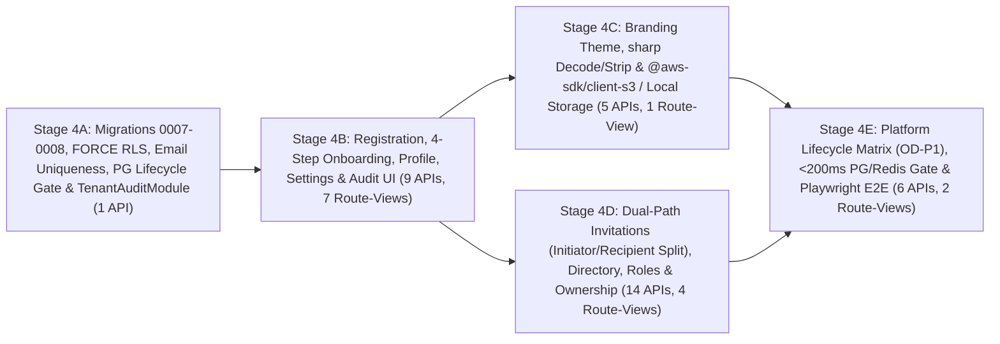

# FunnelTrack360 — Phase 4 Step-by-Step Development Roadmap

**Phase:** Phase 4 — Tenant Onboarding & Management (`Modules 4.1–4.10`)  
**Total Planned Deliverables:** **`35` REST API Endpoints** (`#1`–`#35`) · **`14` Frontend Route-Views** (`RV-01`–`RV-14`: `11` new + `3` updated) · **`7` New `FORCE RLS` Tables** (`22` total) · **`10` New `TENANT` Permissions** (`24` total)  
**Confirmed Delivery Model (`D6 — CONFIRMED`):** `5` Independently Reviewable Vertical Implementation PRs (`Stage 4A` -> `Stage 4E`) targeting `development`, followed by `1` release promotion PR (`development -> main`) after full Phase 4 sign-off.  
**Document Status:** `PLANNING BASELINE — PRODUCT & TECHNICAL DECISIONS CONFIRMED (AWAITING PR REVIEW)`  
**Last Updated:** 2026-11-14

> [!IMPORTANT]
> **Pre-Implementation Git Alignment & Review Gate:**
> 1. All product and technical decisions (`D1`–`D6`, `OD-T1: sharp`, `OD-T2: @aws-sdk/client-s3`, `OD-P1`: require suspension or deactivation before cancellation, `OD-P2`: `365 days` hot audit retention) are **confirmed** in [phase-4-acceptance-criteria.md](file:///d:/FT360/docs/planning/phase-4/phase-4-acceptance-criteria.md).
> 2. Implementation begins on `Stage 4A` only after this documentation PR (`feature/phase-4-planning -> development`) receives independent review and merges.

---

## 1. Stage Dependency Graph & Delivery Tally

| Stage | Endpoints Delivered | Route-Views Delivered | Cumulative Totals |
|---|---|---|---|
| **`Stage 4A`** | `1` (`#29`) | `0` | `1 / 35` APIs · `0 / 14` Views |
| **`Stage 4B`** | `9` (`#1`–`#9`) | `7` (`RV-01`–`RV-06`, `RV-11`: `4` new + `3` updated) | `10 / 35` APIs · `7 / 14` Views |
| **`Stage 4C`** | `5` (`#10`–`#14`) | `1` (`RV-07`: `1` new, plus Step 3 in `RV-03`) | `15 / 35` APIs · `8 / 14` Views |
| **`Stage 4D`** | `14` (`#15`–`#28`) | `4` (`RV-08`–`RV-10`, `RV-12`: `4` new, plus Step 4 in `RV-03`) | `29 / 35` APIs · `12 / 14` Views |
| **`Stage 4E`** | `6` (`#30`–`#35`) | `2` (`RV-13`–`RV-14`: `2` new, plus `/platform` nav link) | **`35 / 35` APIs · `14 / 14` Views** |

---

## 2. Detailed Stage Specifications

---

### Stage 4A — Database Schema (`0007`–`0008`), `FORCE RLS`, Global Email Uniqueness, PG Lifecycle Gate & `TenantAuditModule`
- **Primary Owner:** Tushar (Migrations `0007`–`0008`, `SECURITY DEFINER` routines, Guard/Redis outage fallback) & Mansi (`TenantAuditModule` & DB/concurrency/RLS negative tests)
- **Branch (`D6`):** `feature/phase-4a-schema-rls-audit` -> PR into `development`

1. **Requirements:**
   - Deliver forward & rollback SQL migrations `0007` and `0008` without altering `0001`–`0006` or weakening existing RLS/grants.
   - Seed `10` new canonical 3-segment `TENANT` permissions (`24` total permissions).
   - Introduce `TenantPermissionGuard` and wrap all `RedisSessionCacheService` methods (`isSessionTombstoned`, `tombstoneSessions`, `cacheActiveSession`, `getCachedSession`, `evictSessionCache`) in resilient `try/catch` PostgreSQL fallback so 4-layer PostgreSQL lifecycle validation (`fn_auth_validate_session` + `fn_verify_tenant_membership` + `withVerifiedMemberTransaction` + `fn_assert_tenant_operational` / `fn_is_current_tenant_operational()`) enforces tenant suspension/inactivity directly in PostgreSQL when Redis is unavailable.
   - Implement `TenantAuditModule` (`#29 GET /api/v1/workspace/audit-logs`, field-diff builder, recursive secret sanitizer, mandatory `correlation_id`, `365`-day hot retention baseline `OD-P2`).
2. **Database Scope:**
   - **Migration `0007`:** Extend `tenants` (`DEACTIVATED` status, `deactivated_at`, `cancelled_at`, `status_reason`, `onboarding_completed_at`, `created_by_user_id`, updated `trigger_protect_tenant_lifecycle`), `tenant_memberships` (`is_primary_owner`, `suspended_at`, `revoked_at`, `status_reason`, `uq_tenant_memberships_primary_owner`), and `users` (`chk_users_email_canonical_trimmed` + functional unique index `uq_users_email_normalized` reinforcing `uq_users_email` against concurrent duplicate global email registration); seed `10` permissions; create `tenant_onboarding_states`, `tenant_profiles`, `tenant_settings` (`allow_member_directory_view DEFAULT FALSE` per `D4`, `invitation_expiry_hours DEFAULT 168` per `D3`), `tenant_branding_assets`, `tenant_branding_settings`, and `tenant_audit_logs` (`FORCE RLS` + `fn_is_current_tenant_operational()` write policies, composite FKs, immutability & secret-key check).
   - **Migration `0008`:** Create `tenant_invitations` (column-level `SELECT` omitting `token_hash` for `ft360_app`, plus initiator/recipient check constraints `chk_ti_pending_recipient_unbound` & `chk_ti_initiator_recipient_distinct`); extend `auth_email_outbox` (`user_id DROP NOT NULL`, add `initiated_by_user_id UUID NULL` + `(tenant_id, invitation_id)` composite FK, expand `chk_auth_email_outbox_kind` with `'TENANT_INVITATION'`, add `chk_auth_email_outbox_anchor` requiring `user_id IS NULL` on `'TENANT_INVITATION'`, update `fn_auth_claim_email_outbox_*` with `fn_assert_tenant_operational`); update `fn_auth_validate_session` to join `public.tenants`; create narrow `SECURITY DEFINER` routines (`fn_assert_tenant_operational`, `fn_check_tenant_slug_available`, `fn_tenant_provision_organization`, `fn_platform_transition_tenant_status` [enforcing `OD-P1`], `fn_tenant_list_workspace_members`, `fn_tenant_evict_member_sessions`, `fn_tenant_transfer_primary_owner`, `fn_tenant_issue_or_resend_invitation`, `fn_tenant_enqueue_invitation_email_outbox`, `fn_tenant_revoke_invitation`, `fn_invitation_preview_by_token`, `fn_invitation_accept_existing_user`, `fn_invitation_accept_new_user` [with `pg_advisory_xact_lock` + `23505` duplicate email handling]) plus `trigger_enforce_admin_membership_type()` and serialized `FOR UPDATE` `trigger_prevent_last_tenant_admin_removal()`.
3. **API Contracts (`1`):** `#29 GET /api/v1/workspace/audit-logs`.
4. **Planned Tests (`PLANNED — NOT EXECUTED`):** `UT-P4-05`, `UT-P4-07`, `UT-P4-08`, `DB-P4-01..07`, `RLS-P4-01..06`, `SEC-P4-08`, `SEC-P4-13`, `SEC-P4-16`, `SEC-P4-17`.
5. **Documentation Updates:** [01-er-diagrams.md](file:///d:/FT360/docs/database/01-er-diagrams.md), [02-database-schema.md](file:///d:/FT360/docs/database/02-database-schema.md), [03-sql-migrations-and-indexing.md](file:///d:/FT360/docs/database/03-sql-migrations-and-indexing.md), [04-rls-policies.md](file:///d:/FT360/docs/database/04-rls-policies.md).
6. **Required Independent Reviewer:** `@NakshtraSulakhe`.

---

### Stage 4B — Self-Service Registration (`TRIAL`), 4-Step Onboarding Wizard, Organization Profile & Settings
- **Primary Owner:** Tushar (Backend `TenantsModule`) & Nakshatra (`WorkspaceAdminLayout`, `RV-01`–`RV-06`, `RV-11`)
- **Branch (`D6`):** `feature/phase-4b-registration-onboarding-profile-settings` -> PR into `development`
- **Dependencies:** `Stage 4A` merged into `development`.

1. **Requirements:**
   - Implement Modules `4.1` (Registration starting in `TRIAL` per `D1`, `<= 5` owned tenants per `D2`, multi-tier rate-limited slug availability failing closed `503` on Redis outage), `4.2` (Resumable 4-Step Onboarding Wizard), `4.3` (Organization Profile), `4.8` (Organization Settings: `168h` invite expiry `D3`, restricted directory default `D4`, Redis `t:{tenantId}:settings:active` cache with PG fallback), and workspace audit UI (`4.10`).
2. **Frontend Route-Views (`7`: `4` New + `3` Updated):**
   - `RV-01` `/organizations/new` *(New)*, `RV-02` `/select-organization` *(Updated)*, `RV-03` `/workspace/onboarding` *(New — Steps 1 & 2 live, Steps 3 & 4 skippable until `4C`/`4D`)*, `RV-04` `/workspace` *(Updated)*, `RV-05` `/workspace/organization/profile` *(New)*, `RV-06` `/workspace/organization/settings` *(New)*, `RV-11` `/workspace/admin` *(Updated — unified domain + auth audit tabs)*.
3. **API Contracts (`9`):** `#1`–`#9`.
4. **Planned Tests (`PLANNED — NOT EXECUTED`):** `UT-P4-01`, `UT-P4-04`, `IT-P4-01..03`, `SEC-P4-02`, `SEC-P4-07` (slug rules), `SEC-P4-12`, `UI-P4-01..02`.
5. **Documentation Updates:** [06-api-architecture.md](file:///d:/FT360/docs/architecture/06-api-architecture.md), [02-local-development-setup.md](file:///d:/FT360/docs/operations/02-local-development-setup.md).
6. **Required Independent Reviewer:** `@Mansi`.

---

### Stage 4C — Organization Branding, `sharp` Image Decoding/Stripping & `@aws-sdk/client-s3` / Local Asset Storage
- **Primary Owner:** Nakshatra (`BrandingModule` extension, `TenantAssetStorageService`, `RV-07` & Step 3)
- **Branch (`D6`):** `feature/phase-4c-tenant-branding-and-assets` -> PR into `development`
- **Dependencies:** `Stage 4B` merged into `development`; adds confirmed packages **`sharp`** (`OD-T1`) and **`@aws-sdk/client-s3`** (`OD-T2`) to `apps/api/package.json`.

1. **Requirements:**
   - Implement Module `4.9`: `BrandingService.resolveTenantBranding(tenantId)` (`TENANT -> PLATFORM -> BOOTSTRAP_DEFAULT`, cached in `t:{tenantId}:branding:resolved` with PG fallback), 7-layer `sharp` asset pipeline (byte bounds, unconditional `.svg`/HTML rejection `415`, magic-byte check, dimension & pixel-count bomb limits `<= 4.19 MP` / `<= 0.26 MP`, full pixel-stream decoding via `sharp`, EXIF/XMP/IPTC/chunk stripping & clean re-encoding), isolated storage (`D5`: local outside web root in dev/CI; private S3 via `@aws-sdk/client-s3` in staging/production), and CSP-sandboxed authenticated streaming.
2. **Frontend Route-Views (`1` New + `RV-03` Step 3 Activation):**
   - `RV-07` `/workspace/organization/branding` *(New)* + live `StepBrandingForm` in `RV-03`.
3. **API Contracts (`5`):** `#10`–`#14`.
4. **Planned Tests (`PLANNED — NOT EXECUTED`):** `UT-P4-03`, `UT-P4-06`, `IT-P4-04`, `SEC-P4-01` (cross-tenant asset stream `404`), `SEC-P4-11`, `UI-P4-03`.
5. **Documentation Updates:** [01-system-architecture.md](file:///d:/FT360/docs/architecture/01-system-architecture.md), [02-local-development-setup.md](file:///d:/FT360/docs/operations/02-local-development-setup.md).
6. **Required Independent Reviewer:** `@TusharPhalak44`.

---

### Stage 4D — Dual-Path User Invitations (Initiator/Recipient Separation), Member Directory, Roles & Admin Management
- **Primary Owner:** Mansi (`TenantInvitationsModule`, `TenantMembershipsModule`, Outbox template & `RV-08`–`RV-10`, `RV-12`)
- **Branch (`D6`):** `feature/phase-4d-invitations-memberships-admins` -> PR into `development`
- **Dependencies:** `Stage 4B` merged (sequenced after `Stage 4C`).

1. **Requirements:**
   - Implement Modules `4.5` (Admin roster, serialized last-admin anti-lockout, atomic primary-owner transfer), `4.6` (Issue, resend rotation, revoke, preview, strict initiator vs. recipient identity separation across `tenant_invitations` & `auth_email_outbox`, `FOR UPDATE` existing-user `accept` rejecting initiator/mismatched sessions `403`, concurrent-safe `accept-register` handling `uq_users_email` / `23505` -> `409` without burning losing `PENDING` tokens, and `redactMailLogText()` update in `auth-mail-outbox.service.ts`), and `4.7` (Member directory enforcing `D4` default restriction, role lookup & assignment, surgical single-tenant session unbinding).
2. **Frontend Route-Views (`4` New + `RV-03` Step 4 Activation):**
   - `RV-08` `/workspace/admins` *(New)*, `RV-09` `/workspace/members` *(New)*, `RV-10` `/workspace/invitations` *(New)*, `RV-12` `/invitations/accept` *(New — including Initiator / Wrong-Account Session Guard)* + live `StepBatchInvitesForm` in `RV-03`.
3. **API Contracts (`14`):** `#15`–`#28`.
4. **Planned Tests (`PLANNED — NOT EXECUTED`):** `IT-P4-05`, `RBAC-P4-01..04`, `INV-P4-01..07`, `SEC-P4-03..07`, `SEC-P4-10`, `SEC-P4-15`, `SEC-P4-17`, `SEC-P4-19`, `SEC-P4-20`.
5. **Documentation Updates:** [07-authentication-architecture-and-workflows.md](file:///d:/FT360/docs/architecture/07-authentication-architecture-and-workflows.md), [06-api-architecture.md](file:///d:/FT360/docs/architecture/06-api-architecture.md).
6. **Required Independent Reviewer:** `@NakshtraSulakhe`.

---

### Stage 4E — Platform Control Plane Lifecycle (`OD-P1`), `< 200ms` PG/Redis Suspension Gate & Full E2E Sign-Off
- **Primary Owner:** Tushar (Platform Lifecycle APIs `#30`–`#35`, 4-layer PG/Redis suspension validation, BullMQ gate) & Mansi (`RV-13`–`RV-14`, 20-case negative security suite, Playwright E2E `E2E-P4-01..04`)
- **Branch (`D6`):** `feature/phase-4e-platform-lifecycle-and-e2e-verification` -> PR into `development` (followed by release PR `development -> main` upon authorization)
- **Dependencies:** `Stages 4A–4D` merged into `development`.

1. **Requirements:**
   - Implement Module `4.4` (Platform tenant directory, platform-assisted tenant provisioning, 6-state lifecycle transitions enforcing `OD-P1` [prior `SUSPENDED` or `DEACTIVATED` required before `CANCELLED`] and mandatory `reason`, break-glass owner recovery `#34`, 4-layer PostgreSQL lifecycle validation + resilient Redis invalidation with `< 200ms` denial latency even when Redis is completely offline, BullMQ `verifyTenantJobOperationalStatus` worker gate) and Platform tenant audit inspection (`#35`).
   - Execute full Playwright Chromium E2E suite (`E2E-P4-01..04`) and Phase 1–4 regression gates.
2. **Frontend Route-Views (`2` New + `/platform` Navigation Link):**
   - `RV-13` `/platform/tenants` *(New)*, `RV-14` `/platform/tenants/[tenantId]` *(New)* + `Tenants` tab link in existing `/platform` (`apps/web/src/app/platform/page.tsx`).
3. **API Contracts (`6`):** `#30`–`#35`.
4. **Planned Tests (`PLANNED — NOT EXECUTED`):** `UT-P4-02`, `IT-P4-06`, `LIFE-P4-01..05`, `SEC-P4-09`, `SEC-P4-14`, `SEC-P4-18`, `UI-P4-04`, `E2E-P4-01..04`, plus full Phase 1–3 regression suite.
5. **Documentation Updates:** Create `docs/planning/08-phase-4-task-register.md` and `docs/testing/05-phase-4-test-report.md`; update [00-module-tracking-register.md](file:///d:/FT360/docs/modules/00-module-tracking-register.md), [02-development-roadmap.md](file:///d:/FT360/docs/planning/02-development-roadmap.md), and [README.md](file:///d:/FT360/docs/README.md).
6. **Required Independent Reviewer:** `@NakshtraSulakhe`.

---

## 3. Team Vertical Ownership Summary

| Team Member | Primary Vertical Implementation Ownership | Independent PR Review Duty |
|---|---|---|
| **Tushar** | `Stage 4A` (Migrations `0007`–`0008`, `SECURITY DEFINER` routines, 4-layer PG/Redis outage fallback), `Stage 4B` (`TenantsModule` APIs `#1`–`#9`), `Stage 4E` (Platform Lifecycle APIs `#30`–`#35` & BullMQ Gate) | Reviews **`Stage 4C`** (`@NakshtraSulakhe` Branding & `sharp` / `@aws-sdk/client-s3` PR) |
| **Nakshatra** | `Stage 4B` (`WorkspaceAdminLayout`, `RV-01`–`RV-06`, `RV-11`), `Stage 4C` (End-to-end Tenant Branding, `sharp` Decoding/Stripping & `@aws-sdk/client-s3` / Local Storage `APIs #10`–`#14`, `RV-07`) | Reviews **`Stage 4A`** (DB/RLS), **`Stage 4D`** (Invitations/Memberships), and **`Stage 4E`** (Final Phase 4 Sign-Off) |
| **Mansi** | `Stage 4A` (`TenantAuditModule` `#29` + DB/concurrency/RLS negative tests), `Stage 4D` (Dual-Path Invitations, Directory, Roles & Admin Ownership `APIs #15`–`#28`, `RV-08`–`RV-10`, `RV-12`), `Stage 4E` (`RV-13`–`RV-14`, `SEC-P4-01..20` & Playwright `E2E-P4-01..04`) | Reviews **`Stage 4B`** (`@TusharPhalak44` & `@NakshtraSulakhe` Registration/Onboarding PR) |
