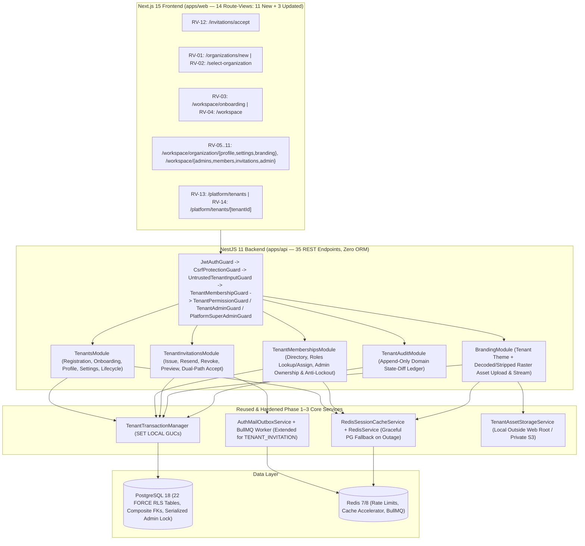

# FunnelTrack360 — Phase 4 Overview: Tenant Onboarding & Management

**Phase:** Phase 4 — Tenant Onboarding & Management (`M01` Platform Tenant Controls, `M02` Tenant Registration & Lifecycle, `M04` Organization Management, Branding & Settings, `M05` Tenant Role Assignment Integration, `M31` Tenant Audit Ledger)  
**Document Status:** `PLANNING BASELINE — PRODUCT & TECHNICAL DECISIONS CONFIRMED (AWAITING PR REVIEW)`  
**Planned Deliverables Scope:** **`35` REST API Endpoints** (`5` User Onboarding / Public Token, `24` Single-Tenant Workspace, `6` Platform Control Plane) · **`14` Frontend Route-Views** (`11` new `page.tsx` routes + `3` updated Phase 3 `page.tsx` routes) · **`7` New `FORCE RLS` Tables** (`22` total public tables) · **`10` New Canonical `TENANT` Permissions** (`24` total permissions)  
**Baseline Repository State:** `main` (`d41618783ddb6618e310c2d8322dfc64352eb6b2`) & `development` (`627b3fe521ae8a1fd314ee27060cc3439252b588`) — **100% synchronized with `origin`, zero file-tree drift, post-merge CI Run `#43486676842` (`main`) and Run `#43485500780` (`development`) green**  
**Prepared By:** Tushar (Architecture & M01/M02), Nakshatra (M04 & Frontend UX), Mansi (M03/M05/M31 Security & QA)  
**Last Updated:** 2026-11-14

> [!IMPORTANT]
> **Strict Planning Boundary:** This document suite defines the architecture, database schema, API contracts, UI route-views, permissions, threat model, testing strategy, and staged roadmap for Phase 4. **Zero application code, SQL migrations, or package changes are included in this planning branch (`feature/phase-4-planning`).** Product and technical decisions (`D1–D6`, `OD-T1`, `OD-T2`, `OD-P1`, `OD-P2`) have been confirmed by project leadership; implementation will begin on Stage `4A` only after independent PR review and merge of this planning suite.

---

## 1. Repository, Source Code & SQL Dependency Inspection Summary

### 1.1 Git & CI Baseline Verification
| Check | Verified Live State |
|---|---|
| **Active Local Branch & Working Tree** | `development` (`627b3fe521ae8a1fd314ee27060cc3439252b588`), application source & migrations completely clean |
| **`main` <-> `origin/main`** | Synchronized at `d41618783ddb6618e310c2d8322dfc64352eb6b2` (PR `#4` merge of `development`; CI [Run #43486676842](https://github.com/TusharPhalak44/ft360/actions/runs/43486676842) `completed / success`) |
| **`development` <-> `origin/development`** | Synchronized at `627b3fe521ae8a1fd314ee27060cc3439252b588` (PR `#3` merge of Phase 3; CI [Run #43485500780](https://github.com/TusharPhalak44/ft360/actions/runs/43485500780) `completed / success`) |
| **Tree Delta (`git diff main development`)** | `0` files changed (`main` differs only by non-fast-forward merge commit `d416187`) |

### 1.2 Existing Foundation Capabilities Discovered (Reusable Without Duplication)

| Layer | Existing Implementation (`Phases 1–3`) | Phase 4 Reuse & Extension Strategy |
|---|---|---|
| **Database & Isolation (`0001`–`0006`)** | `PostgreSQL 18` (`uuidv7()`, `citext`, `pgcrypto`, `pg_trgm`), strict `ft360_migrator` vs `ft360_app` (`NOSUPERUSER`, `NOBYPASSRLS`) separation, `FORCE ROW LEVEL SECURITY` on all `15` public tables, `TenantTransactionManager` (`withVerifiedMemberTransaction`, `withAuthenticatedUserTransaction`, `withPlatformAdminTransaction`). | **Reuse 100%** for all `7` new Phase 4 tables (`tenant_onboarding_states`, `tenant_profiles`, `tenant_settings`, `tenant_branding_assets`, `tenant_branding_settings`, `tenant_invitations`, `tenant_audit_logs`). Existing RLS and role separation remain unweakened. |
| **Core Entities (`0003`–`0004`)** | `public.users` (`users_select` RLS + `trigger_protect_user_privileged_fields`), `public.tenants` (`slug`, `legal_name`, `display_name`, `status`, `default_timezone`, `default_currency`, `trigger_protect_tenant_lifecycle`), `public.tenant_memberships` (`(tenant_id, id)` composite FK anchor), `public.permissions` (`14` seeds, `chk_permissions_code_format`), `public.roles` (`trigger_protect_system_roles`), `public.role_permissions` (`trigger_enforce_tenant_permission_scope`), `public.user_role_assignments`. | **Extend incrementally** via forward migrations `0007`–`0008` (preserving `0001`–`0006` untouched); seed `10` new 3-segment `TENANT` permissions; reuse `PlatformDirectoryRepository`, `TenantMembershipRepository`, and `RbacRepository`. |
| **Authentication, Sessions & Guards (`0005`–`0006`)** | Argon2id (`PasswordHashService`), `HttpOnly` JWT + rotating opaque refresh sessions (`auth_sessions` + `auth_refresh_token_history`), `RedisSessionCacheService`, `POST /auth/select-organization`, `POST /auth/exit-organization`, `UntrustedTenantInputGuard`, `CsrfProtectionGuard`, `JwtAuthGuard`, `TenantMembershipGuard` (`PostgresTenantMembershipVerifier`), `TenantAdminGuard`, `PlatformSuperAdminGuard`. | **Reuse directly**; add `TenantPermissionGuard` for non-admin explicit read permissions (`tenant:organization:read`, `tenant:settings:read`, `tenant:branding:read`, `tenant:members:read`) and harden `RedisSessionCacheService` error fallback so Redis outages degrade cleanly to synchronous PostgreSQL session/membership verification (`0ms` staleness). |
| **Durable Mail Outbox (`0006`)** | `public.auth_email_outbox` (`kind` column, `user_id NOT NULL`), `AuthMailOutboxService`, `AuthTransactionalMailProcessor`, HKDF `AES-256-GCM` token sealing, bounded exponential backoff, `drainDueOutboxBatch()`. | **Extend `auth_email_outbox` via Migration `0008`** (see Section 1.3 Compatibility Finding #1) rather than introducing a duplicate mail queue or worker. |
| **Branding Service (`Phase 1`)** | `platform_branding_settings` (`0002`), `BrandingService.resolvePublicBranding()`, `ProductBrandingConfig` (`source: 'TENANT' \| 'PLATFORM' \| 'BOOTSTRAP_DEFAULT'`), CSS variables `--brand-primary` & `--brand-accent`. | **Complete the `TENANT` tier** already defined in `ProductBrandingConfig.source` (`tenant_branding_settings -> platform_branding_settings -> bootstrap defaults`) with `t:{tenantId}:branding:resolved` caching. |
| **Redis & BullMQ (`Phase 1`)** | `RedisService` (`enableOfflineQueue: false`, `maxRetriesPerRequest: 1`, `buildTenantKey`, `buildAuthKey`), `QueueFoundationModule` (`ft360:q` prefix), `createTenantJobEnvelope` / `verifyTenantJobEnvelope`. | **Reuse** for rate limiting, settings/branding cache acceleration, session cache eviction, and tenant-enveloped BullMQ background jobs gated by live operational tenant status checks. |

### 1.3 Direct Source-Code & SQL Dependency Verification Findings

Inspecting the actual Phase 1–3 SQL (`0001`–`0006`) and TypeScript (`apps/api/src/*`) uncovered **5 concrete compatibility constraints** that the revised Phase 4 design explicitly accounts for:

1. **`public.auth_email_outbox` Column & Foreign-Key Constraint ([0006_phase3_auth_security_remediation.up.sql](file:///d:/FT360/db/migrations/0006_phase3_auth_security_remediation.up.sql#L137-L298)):**
   - *Live Code Reality:* The discriminator column is `kind` (`chk_auth_email_outbox_kind IN ('EMAIL_VERIFICATION', 'PASSWORD_RESET')`), `user_id` is `UUID NOT NULL REFERENCES public.users(id)`, and `fn_auth_enqueue_email_outbox` rejects tenant-scoped GUC contexts (`app_current_tenant_id() IS NOT NULL -> 42501`) and requires an existing `public.users` row matching `recipient_email`.
   - *Design Alignment:* Inviting a brand-new user has no `public.users` row yet and executes inside a tenant transaction, while the **initiating admin** (`app_current_user_id()`) must never be conflated with the **invitation recipient**. Migration `0008` therefore alters `auth_email_outbox` (`user_id DROP NOT NULL`, adds `initiated_by_user_id UUID NULL`, `tenant_id UUID NULL`, and `invitation_id UUID NULL` with composite FK `(tenant_id, invitation_id) -> tenant_invitations(tenant_id, id)`, expands `chk_auth_email_outbox_kind` to include `'TENANT_INVITATION'`, and adds `chk_auth_email_outbox_anchor` enforcing `user_id IS NOT NULL` for auth emails while requiring `user_id IS NULL AND (tenant_id, invitation_id) IS NOT NULL` for `'TENANT_INVITATION'`), adds `fn_tenant_enqueue_invitation_email_outbox`, updates `fn_auth_claim_email_outbox_*` to verify operational tenant status (`fn_assert_tenant_operational`) before sending, and extends `redactMailLogText()` in [auth-mail-outbox.service.ts](file:///d:/FT360/apps/api/src/modules/auth/auth-mail-outbox.service.ts#L64-L78) to scrub `/invitations/accept`.
2. **`public.auth_sessions` Column Update Grants & Plane Checks ([0005_authentication_sessions_tokens_and_audit.up.sql](file:///d:/FT360/db/migrations/0005_authentication_sessions_tokens_and_audit.up.sql#L176-L180), [0006_phase3_auth_security_remediation.up.sql](file:///d:/FT360/db/migrations/0006_phase3_auth_security_remediation.up.sql#L1333-L1336)):**
   - *Live Code Reality:* `ft360_app` only has `GRANT UPDATE (revoked_at, revoked_reason, updated_at) ON public.auth_sessions` (no direct `UPDATE` privilege on `active_tenant_id` or `active_membership_id`), and `fn_auth_bind_session_organization` rejects calls when `app_current_tenant_id() IS NOT NULL` or `app_is_super_admin() = TRUE`.
   - *Design Alignment:* Unbinding active tenant context during Platform Tenant Suspension and Tenant Member Suspension/Revocation executes via narrow `SECURITY DEFINER` routines (`fn_platform_transition_tenant_status` and `fn_tenant_evict_member_sessions`) without broadening `ft360_app` column grants on `auth_sessions`.
3. **`public.users` `users_select` RLS Policy Filters `tm.status = 'ACTIVE'` ([0003_users_tenants_and_memberships.up.sql](file:///d:/FT360/db/migrations/0003_users_tenants_and_memberships.up.sql#L264-L280)):**
   - *Live Code Reality:* `users_select` allows tenant-scoped reads of `public.users` only where `tm.status = 'ACTIVE'`. A direct SQL join in `GET /api/v1/workspace/members` would return `0` rows / `NULL` identity columns when a Tenant Admin filters for `SUSPENDED` or `REVOKED` memberships.
   - *Design Alignment:* Preserve `users_select` untouched (so unaccepted `INVITED` global users can never be scraped via `tenant_memberships`), and provide a narrow `SECURITY DEFINER` reader `fn_tenant_list_workspace_members` that verifies caller membership and `tenant:members:manage` permission inside PostgreSQL before returning identity fields for `SUSPENDED`/`REVOKED` rows of `app_current_tenant_id()`.
4. **`fn_record_auth_audit_log` Unscoped Tenant Attribution Guard ([0006_phase3_auth_security_remediation.up.sql](file:///d:/FT360/db/migrations/0006_phase3_auth_security_remediation.up.sql#L1650-L1688)):**
   - *Live Code Reality:* `fn_record_auth_audit_log` rejects (`42501`) unscoped user-plane calls that pass `p_tenant_id IS NOT NULL`, and rejects session-linked calls if `auth_sessions.active_tenant_id` differs from `p_tenant_id`.
   - *Design Alignment:* Keep `fn_record_auth_audit_log` untouched; `fn_tenant_provision_organization` and `fn_invitation_accept_*` bind `auth_sessions.active_tenant_id` first and insert verified bridge entries into `auth_audit_logs` and `tenant_audit_logs` atomically inside those `SECURITY DEFINER` routines.
5. **Redis Outage Behavior in `JwtAuthGuard` & Missing Image/S3 Packages ([jwt-auth.guard.ts](file:///d:/FT360/apps/api/src/common/jwt-auth.guard.ts#L56-L135), [redis.service.ts](file:///d:/FT360/apps/api/src/cache/redis.service.ts#L15-L25), [package.json](file:///d:/FT360/apps/api/package.json)):**
   - *Live Code Reality:* `RedisService` uses `enableOfflineQueue: false`, while `JwtAuthGuard` already validates every session against PostgreSQL (`validateSessionInDb`) and `TenantMembershipGuard` validates every workspace call against PostgreSQL (`PostgresTenantMembershipVerifier` -> `fn_verify_tenant_membership`), yet `JwtAuthGuard` calls `sessionCache.isSessionTombstoned()` without `try/catch`. Additionally, `apps/api/package.json` contains no raster image decoder (`sharp`) or S3 SDK.
   - *Design Alignment:* Wrap all `RedisSessionCacheService` methods (`isSessionTombstoned`, `tombstoneSessions`, `cacheActiveSession`, `getCachedSession`, `evictSessionCache`) and tenant settings/branding cache calls in resilient try/catch helpers so Redis outages degrade cleanly to authoritative 4-layer PostgreSQL lifecycle validation (`fn_auth_validate_session` + `TenantMembershipGuard`/`fn_verify_tenant_membership` + `withVerifiedMemberTransaction` + `fn_assert_tenant_operational` / write RLS `fn_is_current_tenant_operational()`, `0ms` staleness), while rate-limited abuse-sensitive endpoints (`slug-availability`) fail closed (`503`). Approved Stage `4C` packages **`sharp`** (`OD-T1`) and **`@aws-sdk/client-s3`** (`OD-T2`) are recorded in [phase-4-acceptance-criteria.md](file:///d:/FT360/docs/planning/phase-4/phase-4-acceptance-criteria.md).
6. **Global Email Uniqueness Under Concurrent Registration ([0003_users_tenants_and_memberships.up.sql](file:///d:/FT360/db/migrations/0003_users_tenants_and_memberships.up.sql#L26), [0005_authentication_sessions_tokens_and_audit.up.sql](file:///d:/FT360/db/migrations/0005_authentication_sessions_tokens_and_audit.up.sql#L453)):**
   - *Live Code Reality:* `public.users` enforces `CONSTRAINT uq_users_email UNIQUE (email)` (`CITEXT`), but `SELECT ... FOR UPDATE` cannot lock a non-existent email row when two concurrent `accept-register` (or `/auth/register` + `accept-register`) transactions race simultaneously under `READ COMMITTED`.
   - *Design Alignment:* Add `chk_users_email_canonical_trimmed` + functional unique index `uq_users_email_normalized ON public.users (lower(btrim(email::text)))` (`0007`), serialize `fn_invitation_accept_new_user` and `fn_auth_register_user` on `pg_advisory_xact_lock(hashtext('global_user_email:' || lower(btrim(email::text))))`, and map PostgreSQL `23505` (`unique_violation`) to `409 USER_ALREADY_REGISTERED_SIGN_IN_TO_ACCEPT` without consuming the losing transaction's `PENDING` invitation token.

---

### 1.4 Missing Capabilities Planned in Phase 4 (`Modules 4.1 – 4.10`)

| Module | What Exists Today | What Phase 4 Adds |
|---|---|---|
| **4.1 Tenant Registration** | `tenants` table + Super-Admin-only insert policy (`tenants_insert_platform`). | `fn_tenant_provision_organization` atomic provisioning, rate-limited `GET /tenants/slug-availability` (minimal `{ slug, available }` response), `POST /tenants/register` (`/organizations/new`), seeded `tenant_admin` & `member` system roles, primary-owner binding, and `D2` creation quota (`<= 5`). |
| **4.2 Tenant Onboarding** | None. | `tenant_onboarding_states` (`1:1`), resumable 4-step wizard (`/workspace/onboarding`), incomplete-onboarding banner on `/workspace`, and completion validation gate. |
| **4.3 Organization Profile** | `tenants.legal_name` & `tenants.display_name` only. | `tenant_profiles` (`1:1`), `/workspace/organization/profile`, optimistic concurrency (`expectedVersion`), and field-level before/after audit diffs. |
| **4.4 Tenant Lifecycle Mgmt** | `tenants.status` (`5` states) + `TenantMembershipGuard` check. | 6-state lifecycle matrix (`PROVISIONING`, `TRIAL`, `ACTIVE`, `SUSPENDED`, `DEACTIVATED`, `CANCELLED`), mandatory `reason`, `/platform/tenants` & `/platform/tenants/[tenantId]`, synchronous DB session unbinding + Redis invalidation (`0ms` logical / `< 200ms` HTTP enforcement even under Redis outage), invitation freeze, and BullMQ worker pre-execution check. |
| **4.5 Tenant Admin Mgmt** | `TenantAdminGuard` only. | `/workspace/admins`, multiple `INTERNAL` admins, atomic primary-owner transfer (`POST /workspace/admins/transfer-ownership`) + break-glass platform owner recovery, and serialized `FOR UPDATE` PostgreSQL last-active-admin anti-lockout trigger. |
| **4.6 User Invitations** | `'INVITED'` enum string only. | `tenant_invitations` (`SHA-256` `token_hash` unreadable by `ft360_app`), `/workspace/invitations`, `/invitations/accept`, resend rotation, revocation, sealed outbox delivery, and atomic `FOR UPDATE` dual-path acceptance (existing verified user vs. new global user registration). |
| **4.7 Membership Mgmt** | Basic repository methods + `/select-organization`. | `/workspace/members` directory (restricted by default for ordinary members per `D4`), `GET /workspace/roles`, role assignment (`tenant:roles:assign`), membership suspend/reactivate/revoke, multi-tenant user safety, and surgical single-tenant session unbinding. |
| **4.8 Organization Settings** | `default_timezone` & `default_currency` columns only. | `tenant_settings` (`1:1`), `/workspace/organization/settings` (timezone, locale, date/time format, currency, week/fiscal start, invitation expiry hours, member directory visibility), and `t:{tenantId}:settings:active` cache. |
| **4.9 Organization Branding** | `platform_branding_settings` (`0002`). | `tenant_branding_settings` (`1:1`) + `tenant_branding_assets`, `/workspace/organization/branding`, full raster image decoding + dimension/pixel-count limits + metadata stripping (`.svg` unconditionally rejected), isolated storage (`D5`), and CSP-sandboxed authenticated streaming. |
| **4.10 Tenant Audit & Security** | `auth_audit_logs` (`0005`). | `tenant_audit_logs` (append-only, `FORCE RLS`, `before_state`/`after_state` diffs, recursive secret-key check, `correlation_id`), explicit dual-ledger routing rules, `/workspace/admin` unified audit tabs, and `/platform/tenants/[tenantId]` lifecycle audit timeline. |

---

## 2. Target Phase 4 Modular Monolith Architecture

---

## 3. Existing Documentation Registers Scheduled for Update During Approved Implementation

| Existing Register / Document | Path | Scheduled Update Purpose |
|---|---|---|
| **Documentation Master Index** | [README.md](file:///d:/FT360/docs/README.md) | Updated during planning to index `/docs/planning/phase-4/*`; updated at Phase 4 close with execution & test report links. |
| **Permanent Module Tracking Register** | [00-module-tracking-register.md](file:///d:/FT360/docs/modules/00-module-tracking-register.md) | Record Phase 3 merge (`627b3fe` / `d416187`) and track `M01`, `M02`, `M04`, `M05`, `M31` across Stages `4A–4E`. |
| **Master Development Roadmap** | [02-development-roadmap.md](file:///d:/FT360/docs/planning/02-development-roadmap.md) | Track Phase 4 stage gates (`4A–4E`) and completion evidence. |
| **Database ER Diagrams** | [01-er-diagrams.md](file:///d:/FT360/docs/database/01-er-diagrams.md) | Add the `7` Phase 4 tables and composite FK relationships. |
| **Core Database Schema Catalog** | [02-database-schema.md](file:///d:/FT360/docs/database/02-database-schema.md) | Document Migrations `0007`–`0008` tables, `ALTER TABLE` changes, triggers, and column grants. |
| **SQL Migrations & Indexing** | [03-sql-migrations-and-indexing.md](file:///d:/FT360/docs/database/03-sql-migrations-and-indexing.md) | Record forward/rollback scripts, checksums, and partial/composite indexes. |
| **PostgreSQL RLS Policies** | [04-rls-policies.md](file:///d:/FT360/docs/database/04-rls-policies.md) | Document all `22` `FORCE RLS` table policies and narrow `SECURITY DEFINER` routines. |
| **REST API Architecture** | [06-api-architecture.md](file:///d:/FT360/docs/architecture/06-api-architecture.md) | Register all `35` Phase 4 endpoints and guard/permission contracts. |
| **Authentication & Session Workflows** | [07-authentication-architecture-and-workflows.md](file:///d:/FT360/docs/architecture/07-authentication-architecture-and-workflows.md) | Document dual-path invitation acceptance, surgical tenant session unbinding, and Redis-outage fallback behavior. |
| **Local Development Setup** | [02-local-development-setup.md](file:///d:/FT360/docs/operations/02-local-development-setup.md) | Document local storage path (`STORAGE_DRIVER=local`) and registration/invitation env variables. |
| **Phase 4 Task & Test Registers *(Created at Execution)*** | `docs/planning/08-phase-4-task-register.md` & `docs/testing/05-phase-4-test-report.md` | Track Stage `4A–4E` ownership and live CI test evidence. |

---

## 4. Phase 4 Planning Document Suite Index (`10` Documents)

1. [phase-4-overview.md](file:///d:/FT360/docs/planning/phase-4/phase-4-overview.md) — Baseline & live source/SQL verification, reuse vs. gap map, architecture diagram, register map.
2. [phase-4-functional-requirements.md](file:///d:/FT360/docs/planning/phase-4/phase-4-functional-requirements.md) — Functional rules, complete 6-state lifecycle matrix, suspension fallback, last-admin locking, branding decode, invitation & audit rules (`Modules 4.1–4.10`).
3. [phase-4-database-design.md](file:///d:/FT360/docs/planning/phase-4/phase-4-database-design.md) — Existing-table evaluation (`auth_email_outbox`, `users_select`, `auth_sessions`), `7` new `FORCE RLS` tables, composite FKs, serialized anti-lockout triggers, and `SECURITY DEFINER` specs.
4. [phase-4-api-specification.md](file:///d:/FT360/docs/planning/phase-4/phase-4-api-specification.md) — Complete `35`-endpoint REST catalog (`#1–#35`), payloads, permissions, transaction boundaries, errors, and audit events.
5. [phase-4-frontend-screen-plan.md](file:///d:/FT360/docs/planning/phase-4/phase-4-frontend-screen-plan.md) — Complete `14`-route-view Next.js App Router plan (`RV-01`–`RV-14`: `11` new + `3` updated `page.tsx` views).
6. [phase-4-permission-matrix.md](file:///d:/FT360/docs/planning/phase-4/phase-4-permission-matrix.md) — `24`-permission catalog (`14` existing + `10` new) and explicit `35`-endpoint authorization matrix.
7. [phase-4-security-threat-model.md](file:///d:/FT360/docs/planning/phase-4/phase-4-security-threat-model.md) — Explicit threat analysis across all `14` domains and mandatory negative security tests (`SEC-P4-01`–`SEC-P4-18`).
8. [phase-4-test-strategy.md](file:///d:/FT360/docs/planning/phase-4/phase-4-test-strategy.md) — Unit, DB/RLS, concurrency, Redis-outage, API, component, Playwright E2E, and regression specs (`all PLANNED — NOT EXECUTED`).
9. [phase-4-development-roadmap.md](file:///d:/FT360/docs/planning/phase-4/phase-4-development-roadmap.md) — `5` vertical implementation stages (`4A`–`4E`) aligned to the `35` endpoints and `14` route-views.
10. [phase-4-acceptance-criteria.md](file:///d:/FT360/docs/planning/phase-4/phase-4-acceptance-criteria.md) — Measurable Definition of Done and confirmed product/technical decisions (`D1–D6`, `OD-T1`, `OD-T2`, `OD-P1`, `OD-P2`).
