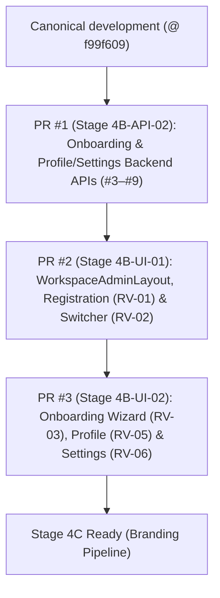

  # FunnelTrack360 — Stage 4B Remaining Scope Implementation Readiness Audit

**Document Version:** 1.0.0  
**Audit Date:** 2026-11-24  
**Audit Scope:** Stage 4B Remaining Scope (APIs `#3`–`#9`, Route-Views `RV-01`–`RV-06`, `RV-11`) & Stage 4C Dependency Interface  
**Authoritative References:** `docs/planning/phase-4/` (`phase-4-api-specification.md`, `phase-4-frontend-screen-plan.md`, `phase-4-functional-requirements.md`, `phase-4-database-design.md`, `phase-4-permission-matrix.md`, `phase-4-acceptance-criteria.md`, `phase-4-development-roadmap.md`)  
**Canonical Baseline:** `development` @ `f99f6099cdd5db40e85b4bf9f2f7b76480c487f5` (Following PR #8 merge)  
**Post-Merge CI Run:** `#45424768047` (`completed / success`)  
**Audit Execution Status:** **READ-ONLY AUDIT COMPLETED**

---

## 1. Executive Summary & Baseline Verification

Stage 4B-API-01 (delivering Public Onboarding Plane Endpoints `#1` `GET /api/v1/tenants/slug-availability` and `#2` `POST /api/v1/tenants/register`) was merged into canonical `development` via **PR #8** (`f99f609`) with zero merge conflicts. All 18 GitHub Actions CI checks on Run `#45424768047` executed and passed cleanly.

This audit evaluates the **remaining Stage 4B implementation scope**, which encompasses:
1. **Onboarding Wizard Backend APIs:** API `#3` (`GET /workspace/onboarding`), API `#4` (`PATCH /workspace/onboarding/steps/:step`), API `#5` (`POST /workspace/onboarding/complete`).
2. **Organization Profile & Settings Backend APIs:** API `#6` (`GET /workspace/organization/profile`), API `#7` (`PUT /workspace/organization/profile`), API `#8` (`GET /workspace/organization/settings`), API `#9` (`PUT /workspace/organization/settings`).
3. **Frontend Route-Views:** `RV-01` (`/organizations/new`), `RV-02` (`/select-organization`), `RV-03` (`/workspace/onboarding`), `RV-04` (`/workspace`), `RV-05` (`/workspace/organization/profile`), `RV-06` (`/workspace/organization/settings`), `RV-11` (`/workspace/admin`).
4. **Shared Frontend Primitives:** `WorkspaceAdminLayout`, `OnboardingStepper`, `ConfirmReasonModal`, `ApiCorrelationErrorBanner`, and `ToastBanner`.

### Key Audit Conclusions:
- **Database Readiness:** **100% Ready.** All required tables (`tenant_onboarding_states`, `tenant_profiles`, `tenant_settings`), companion relationships, RLS write policies (`fn_is_current_tenant_operational()`), check constraints, composite foreign keys, and indexes were already applied and verified in PostgreSQL **Migration `0007`**. **Zero new database migrations are required.**
- **Backend Readiness:** **Architecturally Clear, Scope Missing.** APIs `#3`–`#9` are not yet authored. The underlying execution primitives (`TenantTransactionManager.withVerifiedMemberTransaction`, `TenantMembershipGuard`, `TenantPermissionGuard`, `TenantAdminGuard`, and `TenantAuditService`) are fully operational in production code.
- **Frontend Readiness:** **Primitives Missing.** The Next.js web application (`apps/web`) currently contains Phase 3 auth screens. It lacks the tenant onboarding layout (`WorkspaceAdminLayout`), registration screen (`RV-01`), 4-step wizard (`RV-03`), profile screen (`RV-05`), and settings screen (`RV-06`).
- **Stage 4C Decoupling:** Stage 4B can proceed and deliver end-to-end functionality without blocking on Stage 4C. The onboarding database schema explicitly allows Step 3 (`org-branding`) and Step 4 (`team-invites`) to be skipped or marked complete independently.

---

## 2. Implementation Status by Component

### A. Backend REST API Endpoints (`#1`–`#9`)

| Endpoint # | Path | Method | Plane / Context | Required Permissions | Implementation Status | Verification Evidence |
| :---: | :--- | :---: | :--- | :--- | :---: | :--- |
| **#1** | `/api/v1/tenants/slug-availability` | `GET` | User Onboarding | Authenticated Verified User | **`VERIFIED IMPLEMENTED`** | Merged PR #8 (`tenant-registration.controller.ts`) |
| **#2** | `/api/v1/tenants/register` | `POST` | User Onboarding | Authenticated Verified User | **`VERIFIED IMPLEMENTED`** | Merged PR #8 (`tenant-registration.controller.ts`) |
| **#3** | `/api/v1/workspace/onboarding` | `GET` | Single Tenant | `tenant:organization:read` | **`MISSING (NOT STARTED)`** | Specification only (`phase-4-api-specification.md`) |
| **#4** | `/api/v1/workspace/onboarding/steps/:step` | `PATCH` | Single Tenant | `tenant:organization:manage` | **`MISSING (NOT STARTED)`** | Specification only (`phase-4-api-specification.md`) |
| **#5** | `/api/v1/workspace/onboarding/complete` | `POST` | Single Tenant | `tenant:organization:manage` | **`MISSING (NOT STARTED)`** | Specification only (`phase-4-api-specification.md`) |
| **#6** | `/api/v1/workspace/organization/profile` | `GET` | Single Tenant | `tenant:organization:read` | **`MISSING (NOT STARTED)`** | Specification only (`phase-4-api-specification.md`) |
| **#7** | `/api/v1/workspace/organization/profile` | `PUT` | Single Tenant | `tenant:organization:manage` | **`MISSING (NOT STARTED)`** | Specification only (`phase-4-api-specification.md`) |
| **#8** | `/api/v1/workspace/organization/settings` | `GET` | Single Tenant | `tenant:settings:read` | **`MISSING (NOT STARTED)`** | Specification only (`phase-4-api-specification.md`) |
| **#9** | `/api/v1/workspace/organization/settings` | `PUT` | Single Tenant | `tenant:settings:manage` | **`MISSING (NOT STARTED)`** | Specification only (`phase-4-api-specification.md`) |

### B. Frontend Route-Views (`RV-01`–`RV-06`, `RV-11`)

| View ID | Route Path | File Target | Classification | Layout Requirement | Implementation Status |
| :---: | :--- | :--- | :---: | :--- | :---: |
| **`RV-01`** | `/organizations/new` | `apps/web/src/app/organizations/new/page.tsx` | New | Public Auth Shell / Modal | **`MISSING (NOT STARTED)`** |
| **`RV-02`** | `/select-organization` | `apps/web/src/app/select-organization/page.tsx` | Updated | Auth Shell | **`NEEDS UPDATE`** (Phase 3 basic only; lacks `/organizations/new` button, trial badges) |
| **`RV-03`** | `/workspace/onboarding` | `apps/web/src/app/workspace/onboarding/page.tsx` | New | `WorkspaceAdminLayout` | **`MISSING (NOT STARTED)`** |
| **`RV-04`** | `/workspace` | `apps/web/src/app/workspace/page.tsx` | Updated | `WorkspaceAdminLayout` | **`NEEDS UPDATE`** (Lacks non-blocking setup banner when `onboarding_status === 'IN_PROGRESS'`) |
| **`RV-05`** | `/workspace/organization/profile` | `apps/web/src/app/workspace/organization/profile/page.tsx` | New | `WorkspaceAdminLayout` | **`MISSING (NOT STARTED)`** |
| **`RV-06`** | `/workspace/organization/settings` | `apps/web/src/app/workspace/organization/settings/page.tsx` | New | `WorkspaceAdminLayout` | **`MISSING (NOT STARTED)`** |
| **`RV-11`** | `/workspace/admin` | `apps/web/src/app/workspace/admin/page.tsx` | Updated | `WorkspaceAdminLayout` | **`NEEDS UPDATE`** (Lacks unified domain & security audit tabs) |

---

## 3. Missing Functionality & Detailed Acceptance Criteria

### A. Onboarding Wizard APIs (`#3`, `#4`, `#5`)

#### 1. API #3 — `GET /api/v1/workspace/onboarding`
- **Missing Components:**
  - Controller route inside `@Controller('workspace/onboarding')` with `@UseGuards(TenantMembershipGuard, TenantPermissionGuard)` and `@RequirePermissions('tenant:organization:read')`.
  - Repository query reading from `public.tenant_onboarding_states` under tenant isolation.
  - Service returning `TenantOnboardingStatePayload`:
    ```typescript
    export interface TenantOnboardingStatePayload {
      tenantId: string;
      onboardingStatus: 'IN_PROGRESS' | 'COMPLETED';
      currentStep: 'ORG_PROFILE' | 'ORG_SETTINGS' | 'ORG_BRANDING' | 'TEAM_INVITES' | 'REVIEW_COMPLETE';
      steps: {
        orgProfile: { completed: boolean; completedAt: string | null };
        orgSettings: { completed: boolean; completedAt: string | null };
        orgBranding: { completed: boolean; completedAt: string | null; skipped: boolean };
        teamInvites: { completed: boolean; completedAt: string | null; skipped: boolean };
      };
      completedAt: string | null;
      completedByMembershipId: string | null;
      version: number;
    }
    ```
- **Acceptance Criteria (`AC-4.2.1`):** Must return 200 OK with accurate step status, optimistic lock version, and step completion timestamps for the authenticated tenant.

#### 2. API #4 — `PATCH /api/v1/workspace/onboarding/steps/:step`
- **Missing Components:**
  - Controller supporting parameterized `:step` (`org-profile` | `org-settings` | `org-branding` | `team-invites`).
  - Strict step validation pipe ensuring `skipped: true` is **rejected with HTTP 422 `REQUIRED_ONBOARDING_STEP`** if requested on `org-profile` or `org-settings`.
  - Permission escalation check: Requires `tenant:organization:manage`, plus `tenant:settings:manage` for `org-settings`, `tenant:branding:manage` for `org-branding`, and `tenant:invitations:manage` for `team-invites`.
  - Optimistic locking: Checks `expectedVersion === version` on `tenant_onboarding_states`, rejecting with `409 ONBOARDING_VERSION_CONFLICT` if mismatched.
  - Step Payload Handlers:
    - `org-profile`: Updates `tenant_profiles` + `tenants.display_name` + `tenants.legal_name`, sets `org_profile_completed_at = NOW()`, updates `current_step = 'ORG_SETTINGS'`, increments `version`.
    - `org-settings`: Updates `tenant_settings` + syncs `tenants.default_timezone`/`currency`, sets `org_settings_completed_at = NOW()`, updates `current_step = 'ORG_BRANDING'`, increments `version`.
    - `org-branding`: If `skipped: true`, sets `org_branding_skipped = TRUE`, `current_step = 'TEAM_INVITES'`. If payload provided, delegates to branding update.
    - `team-invites`: If `skipped: true`, sets `team_invites_skipped = TRUE`, `current_step = 'REVIEW_COMPLETE'`.
  - Audit logging: Records `TENANT_ONBOARDING_STEP_SAVED` in `tenant_audit_logs`.
- **Acceptance Criteria (`AC-4.2.1`):** All step updates execute atomically within a single `withVerifiedMemberTransaction`.

#### 3. API #5 — `POST /api/v1/workspace/onboarding/complete`
- **Missing Components:**
  - Controller route requiring `TenantMembershipGuard` + `TenantAdminGuard` + `@RequirePermissions('tenant:organization:manage')`.
  - Prerequisite validation: Asserts `org_profile_completed_at IS NOT NULL` and `org_settings_completed_at IS NOT NULL`. Rejects with `422 ONBOARDING_PREREQUISITES_INCOMPLETE` if either required step is uncompleted.
  - State update: Sets `onboarding_status = 'COMPLETED'`, `completed_at = NOW()`, `completed_by_membership_id = verifiedMembershipId`, `current_step = 'REVIEW_COMPLETE'`, and syncs `tenants.onboarding_completed_at = NOW()`.
  - Audit logging: Records `TENANT_ONBOARDING_COMPLETED` in `tenant_audit_logs`.
- **Acceptance Criteria (`AC-4.2.2`):** Conforms strictly to the database constraint `chk_tos_completion_integrity` in PostgreSQL.

---

### B. Profile & Settings APIs (`#6`, `#7`, `#8`, `#9`)

#### 1. API #6 & #7 — Organization Profile
- **Missing Components:**
  - `GET /api/v1/workspace/organization/profile`: Reads `tenants` (`id`, `slug`, `display_name`, `legal_name`, `status`, `created_at`) joined with `tenant_profiles` (`organization_type`, `industry`, `company_size_band`, `website_url`, addresses, contacts, `version`).
  - `PUT /api/v1/workspace/organization/profile`:
    - DTO validation enforcing `forbidNonWhitelisted: true` to prevent client modification of immutable columns (`id`, `tenant_id`, `slug`, `status`).
    - Validates ISO country codes, valid URLs, and E.164 phone formats.
    - Optimistic lock enforcement on `tenant_profiles.version`: Throws `409 PROFILE_VERSION_CONFLICT` if `expectedVersion !== currentVersion`.
    - Field-diff auditing: Computes before/after JSON diff and emits `TENANT_PROFILE_UPDATED` in `tenant_audit_logs`.

#### 2. API #8 & #9 — Organization Settings
- **Missing Components:**
  - `GET /api/v1/workspace/organization/settings`:
    - Checks Redis cache `t:{tenantId}:settings:active`.
    - On cache miss, queries `tenant_settings` via `withVerifiedMemberTransaction`, caches in Redis (`TTL 300s`), and returns `TenantSettingsPayload`.
    - Resilient fail-safe: Falls back seamlessly to direct PostgreSQL query if Redis is unreachable.
  - `PUT /api/v1/workspace/organization/settings`:
    - Validates IANA timezone, BCP-47 locale, ISO-4217 3-letter currency, `invitationExpiryHours` (`1..720`, default `168` per `D3`), and `allowMemberDirectoryView` (`BOOLEAN`, default `FALSE` per `D4`).
    - Optimistic locking: Rejects with `409 SETTINGS_VERSION_CONFLICT` on version mismatch.
    - Side effects: Synchronizes `tenants.default_timezone` and `tenants.default_currency`.
    - Invalidation: Deletes Redis cache key `t:{tenantId}:settings:active`.
    - Audit logging: Records `TENANT_SETTINGS_UPDATED` in `tenant_audit_logs`.

---

### C. Frontend Route-Views (`RV-01`–`RV-06`, `RV-11`)

#### 1. `RV-01`: Self-Service Registration (`/organizations/new`)
- Form inputs: `displayName`, `legalName`, `slug`, `organizationType`, `industry`, `countryCode`, `defaultTimezone`, `defaultCurrency`.
- Real-time debounced slug availability checking against API `#1` (`/api/v1/tenants/slug-availability`) with anti-jitter and inline error states.
- Submission to API `#2` (`POST /api/v1/tenants/register`), which sets session cookies and automatically transitions the user into `/workspace/onboarding` (`RV-03`).

#### 2. `RV-02`: Updated Organization Switcher (`/select-organization`)
- Displays all organizations associated with the authenticated user with status badges (`TRIAL`, `ACTIVE`, `SUSPENDED`).
- Identifies primary owner status.
- Adds clear call-to-action button: `+ Create New Organization` navigating to `/organizations/new` (`RV-01`).

#### 3. `RV-03`: Resumable 4-Step Onboarding Wizard (`/workspace/onboarding`)
- Stepper component tracking: Step 1 (Profile), Step 2 (Settings), Step 3 (Branding), Step 4 (Team Invites).
- Hydrates initial state from API `#3`.
- Submits Step 1 and Step 2 data to API `#4`.
- Allows Step 3 (`Branding`) to be skipped via `{ skipped: true }` until Stage 4C.
- Allows Step 4 (`Team Invites`) to be skipped via `{ skipped: true }` until Stage 4D.
- Invokes API `#5` upon completion and redirects to `/workspace` (`RV-04`).

#### 4. `RV-04`: Workspace Overview (`/workspace`)
- If `onboardingStatus === 'IN_PROGRESS'` and user has `tenant:organization:manage`, displays non-blocking persistent banner:
  > *"Your workspace onboarding is in progress. Complete setup to configure company details and preferences. [Resume Setup →]"*

#### 5. `RV-05`: Organization Profile Screen (`/workspace/organization/profile`)
- Form bound to API `#6` and `#7` with tabs for General Identity, Business Registry, and Primary Contacts.
- Prevents mutation of slug and status. Handles `409 PROFILE_VERSION_CONFLICT` with conflict reload prompt.

#### 6. `RV-06`: Organization Settings Screen (`/workspace/organization/settings`)
- Regional formatting controls (Timezone, Date Format, Time Format, Currency).
- Governance controls: `invitationExpiryHours` (slider/input between 1 and 720 hours) and `allowMemberDirectoryView` toggle (default false per `D4`).
- Bound to API `#8` and `#9`.

#### 7. `RV-11`: Workspace Admin & Audit Console (`/workspace/admin`)
- Updated tabbed view:
  - Tab 1: Organization Overview & Companion Records.
  - Tab 2: Security & Session Logins (`/workspace/admin/auth-logs`).
  - Tab 3: Domain & Workspace Activity Audit Trail (consuming API `#29` `GET /api/v1/workspace/audit-logs`).

---

## 4. Cross-Component Dependency Matrices

### A. Backend-to-Frontend Dependency Matrix

| Frontend Route View | Consumed Backend APIs | Shared DTOs & Payloads Required | Blocking Condition |
| :--- | :--- | :--- | :--- |
| **`RV-01` (`/organizations/new`)** | API `#1` (`GET /slug-availability`)<br>API `#2` (`POST /register`) | `CheckSlugAvailabilityQuery`, `CheckSlugAvailabilityResponsePayload`, `TenantRegistrationRequestPayload` | **None** (APIs `#1` & `#2` are merged and live) |
| **`RV-02` (`/select-organization`)** | `/api/v1/auth/me`<br>`/api/v1/auth/select-organization` | `AuthMeResponsePayload`, `SelectOrganizationResponsePayload` | **None** (Auth endpoints live since Phase 3) |
| **`RV-03` (`/workspace/onboarding`)** | API `#3` (`GET /onboarding`)<br>API `#4` (`PATCH /onboarding/steps/:step`)<br>API `#5` (`POST /onboarding/complete`) | `TenantOnboardingStatePayload`, `UpdateOnboardingStepPayload`, `CompleteOnboardingPayload` | Blocked on **APIs `#3`, `#4`, `#5`** |
| **`RV-04` (`/workspace`)** | `/api/v1/workspace/context`<br>API `#3` (`GET /onboarding`) | `WorkspaceBoundaryContextPayload`, `TenantOnboardingStatePayload` | Blocked on **API `#3`** |
| **`RV-05` (`/organization/profile`)** | API `#6` (`GET /organization/profile`)<br>API `#7` (`PUT /organization/profile`) | `OrganizationProfilePayload`, `UpdateOrganizationProfileRequest` | Blocked on **APIs `#6`, `#7`** |
| **`RV-06` (`/organization/settings`)** | API `#8` (`GET /organization/settings`)<br>API `#9` (`PUT /organization/settings`) | `TenantSettingsPayload`, `UpdateTenantSettingsRequest` | Blocked on **APIs `#8`, `#9`** |
| **`RV-11` (`/workspace/admin`)** | `/api/v1/workspace/context`<br>API `#29` (`GET /workspace/audit-logs`) | `TenantAuditLogEntry`, `WorkspaceBoundaryContextPayload` | **None** (API `#29` is merged and live) |

### B. Database Dependency Matrix

| Database Entity | Migration Origin | Foreign Key & Constraint Dependencies | RLS Policy Status | Required Database Changes |
| :--- | :---: | :--- | :---: | :---: |
| `public.tenants` | `0003` / `0007` | Primary tenant record; `status IN ('PROVISIONING', 'TRIAL', 'ACTIVE', 'SUSPENDED', 'DEACTIVATED', 'CANCELLED')` | `FORCE RLS` Enabled | **Zero** (Already verified) |
| `public.tenant_onboarding_states` | `0007` | `FK -> tenants(id) ON DELETE CASCADE`; `chk_tos_completion_integrity` | `FORCE RLS` Enabled | **Zero** (Already verified) |
| `public.tenant_profiles` | `0007` | `FK -> tenants(id) ON DELETE CASCADE`; `chk_tp_organization_type`, `chk_tp_industry` | `FORCE RLS` Enabled | **Zero** (Already verified) |
| `public.tenant_settings` | `0007` | `FK -> tenants(id) ON DELETE CASCADE`; `chk_ts_week_start`, `chk_ts_invitation_expiry` | `FORCE RLS` Enabled | **Zero** (Already verified) |
| `public.tenant_audit_logs` | `0007` | `FK -> tenants(id) ON DELETE RESTRICT`; Immutability trigger `trigger_prevent_tenant_audit_logs_mutation()` | `FORCE RLS` Enabled | **Zero** (Already verified) |

---

## 5. Permission & Authorization Matrix

| Endpoint | Target Resource | Authorization Guards | Required Permissions | Negative Test Expectations |
| :--- | :--- | :--- | :--- | :--- |
| **API #3** | `/workspace/onboarding` | `TenantMembershipGuard`<br>`TenantPermissionGuard` | `tenant:organization:read` | Denies unauthenticated (401), unverified session (401), missing permission (403), wrong plane (403). |
| **API #4** | `/workspace/onboarding/steps/:step` | `TenantMembershipGuard`<br>`TenantAdminGuard`<br>`TenantPermissionGuard` | `tenant:organization:manage`<br>+ Step-specific permission | Denies non-admin member (403), stale version (409), required step skipping (422). |
| **API #5** | `/workspace/onboarding/complete` | `TenantMembershipGuard`<br>`TenantAdminGuard`<br>`TenantPermissionGuard` | `tenant:organization:manage` | Denies incomplete steps (422), stale version (409), non-admin member (403). |
| **API #6** | `/workspace/organization/profile` | `TenantMembershipGuard`<br>`TenantPermissionGuard` | `tenant:organization:read` | Denies cross-tenant query (403 RLS violation), unauthenticated (401). |
| **API #7** | `/workspace/organization/profile` | `TenantMembershipGuard`<br>`TenantAdminGuard`<br>`TenantPermissionGuard` | `tenant:organization:manage` | Denies non-admin (403), slug/status mutation attempts (400), stale version (409). |
| **API #8** | `/workspace/organization/settings` | `TenantMembershipGuard`<br>`TenantPermissionGuard` | `tenant:settings:read` | Denies cross-tenant query (403 RLS violation), unauthenticated (401). |
| **API #9** | `/workspace/organization/settings` | `TenantMembershipGuard`<br>`TenantAdminGuard`<br>`TenantPermissionGuard` | `tenant:settings:manage` | Denies non-admin (403), invalid IANA/ISO currency (400), invalid invite TTL (400), stale version (409). |

---

## 6. Security & Tenant Isolation Analysis

1. **Strict PostgreSQL Row-Level Security (`FORCE RLS`):**
   - All runtime queries for APIs `#3`–`#9` execute through `TenantTransactionManager.withVerifiedMemberTransaction()`, which sets:
     - `SET LOCAL app.current_tenant_id = '<tenantId>'`
     - `SET LOCAL app.current_user_id = '<userId>'`
     - `SET LOCAL app.current_membership_id = '<membershipId>'`
     - `SET LOCAL app.is_super_admin = 'false'`
   - Tables `tenant_onboarding_states`, `tenant_profiles`, and `tenant_settings` enforce `tenant_id = public.app_current_tenant_id()` on `SELECT`, and `tenant_id = public.app_current_tenant_id() AND public.fn_is_current_tenant_operational()` on `INSERT` and `UPDATE`.
   - Direct cross-tenant data traversal is mathematically rejected by the PostgreSQL engine.

2. **Zero Client Trust for Tenant Context:**
   - No endpoint accepts `tenant_id` or `membership_id` from the URL path, request body, or client headers.
   - All identifiers are securely populated server-side from `req.tenantContext` as verified by `TenantMembershipGuard`.

3. **Optimistic Versioning & Concurrency Protection:**
   - APIs `#4`, `#5`, `#7`, and `#9` enforce optimistic concurrency via an integer `version` column.
   - If two concurrent administrators attempt to update settings or profile fields simultaneously, the second write receives HTTP 409 (`*_VERSION_CONFLICT`), preventing silent overwrites.

4. **Dual-Ledger Governance & Diff Sanitization:**
   - All profile, settings, and onboarding mutations log structured field diffs (`before_state`, `after_state`) to `public.tenant_audit_logs`.
   - The PostgreSQL constraint `chk_tal_no_forbidden_secrets` automatically rejects any audit payload containing secret keys (`token`, `secret`, `password`, `hash`).

5. **Redis Isolation & Fail-Safe Architecture:**
   - Settings cache uses strict tenant namespace keys: `t:{tenantId}:settings:active`.
   - If Redis becomes unavailable, `TenantSettingsService` must degrade gracefully to direct PostgreSQL reads without raising 500 errors.

---

## 7. Stage 4C Dependency & Contract Assessment

### Exact Contracts Required Before Stage 4C Integration:
1. **API #4 Step Bounding:**
   - The onboarding step endpoint `PATCH /workspace/onboarding/steps/:step` must accept `:step = 'org-branding'` and `{ skipped: boolean, payload?: OrgBrandingDto }`.
   - In Stage 4B, the backend must accept `{ skipped: true }` and persist `org_branding_skipped = TRUE`.
2. **API #5 Prerequisites:**
   - API #5 (`POST /workspace/onboarding/complete`) must assert completion of Step 1 (`ORG_PROFILE`) and Step 2 (`ORG_SETTINGS`), while treating Step 3 (`ORG_BRANDING`) as optional.
3. **Frontend Stepper Interface (`RV-03`):**
   - The `OnboardingStepper` component must support 4 steps:
     - Step 1: `StepProfileForm` (Stage 4B live)
     - Step 2: `StepSettingsForm` (Stage 4B live)
     - Step 3: `StepBrandingForm` (Stage 4B placeholder with `Skip for Now` button; fully implemented in Stage 4C)
     - Step 4: `StepBatchInvitesForm` (Stage 4B placeholder with `Skip for Now` button; fully implemented in Stage 4D)
4. **Shared Types Contract:**
   - The shared type `TenantOnboardingStatePayload` must define `orgBranding: { completed: boolean; completedAt: string | null; skipped: boolean }` so Stage 4C can integrate seamlessly without altering shared contracts.

---

## 8. Quality Assurance & Testing Plan

### A. Unit Tests (Estimated: ~55 New Tests)
- `TenantOnboardingService`:
  - 4-step state retrieval and completion check logic.
  - Step skip validation (rejecting skip on profile/settings, allowing skip on branding/invites).
  - Optimistic locking version conflict handling (`409`).
  - Prerequisite validation before completion (`422`).
- `OrganizationProfileService`:
  - Fetch profile and companion mapping.
  - Profile update with `displayName`/`legalName` synchronization.
  - Field diff computation and audit log emission.
- `TenantSettingsService`:
  - Cache-aside read pattern (Redis hit, Redis miss, Redis offline fallback).
  - Cache invalidation on update.
  - Timezone, locale, currency, invite TTL validation.

### B. Integration Tests (Estimated: ~20 New Tests)
- File: `apps/api/test/integration/phase4b-tenant-onboarding-and-settings.int-spec.ts`
  - Exercise APIs `#3`–`#9` over live PostgreSQL 18 and Redis.
  - Verify RLS isolation: Attempting to query another tenant's profile or settings fails with 404 or empty results.
  - Verify optimistic locking: Send conflicting version numbers and assert HTTP 409.
  - Verify audit logs: Verify rows appear in `public.tenant_audit_logs` with sanitized JSON diffs.

### C. Frontend Unit & Component Tests
- `StepProfileForm.spec.tsx`: Form validation and submission.
- `StepSettingsForm.spec.tsx`: Regional settings validation and defaults.
- `OnboardingStepper.spec.tsx`: Navigation and skip logic.
- `WorkspaceAdminLayout.spec.tsx`: Topbar rendering, organization pill, permission-filtered sidebar.

### D. Playwright E2E Tests
- Complete self-service registration (`RV-01`), transition to onboarding wizard (`RV-03`), complete Step 1 & 2, skip Step 3 & 4, finalize onboarding, and land on `/workspace` (`RV-04`).

---

## 9. Implementation Complexity & PR Breakdown Strategy

To maintain strict code quality, ease code reviews, and guarantee continuous green CI, the remaining Stage 4B scope should be split into **three reviewable PRs**:

### Recommended PR Breakdown:



#### PR 1 — Stage 4B-API-02: Onboarding, Profile & Settings Backend APIs
- **Scope:**
  - Shared types for APIs `#3`–`#9` in `packages/shared-types`.
  - Backend modules: `TenantOnboardingModule`, `OrganizationProfileModule`, `TenantSettingsModule`.
  - Full unit test suites (`~55` tests) and integration suite (`~20` tests).
- **Complexity:** **Medium (3–4 days)**
- **Risk:** Low (Database schemas already verified).

#### PR 2 — Stage 4B-UI-01: Shared Layout & Registration Flows
- **Scope:**
  - `WorkspaceAdminLayout` with topbar branding, tenant switcher, and permission navigation.
  - `RV-01` (`/organizations/new`) with debounced slug checker.
  - `RV-02` (`/select-organization`) updated with status pills and creation trigger.
  - API client methods in `apps/web/src/lib/api/client.ts`.
- **Complexity:** **Medium (2–3 days)**
- **Risk:** Low (Standard React/Next.js UI).

#### PR 3 — Stage 4B-UI-02: Onboarding Wizard & Management Screens
- **Scope:**
  - `RV-03` (`/workspace/onboarding`) with 4-step stepper (Steps 1 & 2 live, 3 & 4 skippable).
  - `RV-04` (`/workspace`) setup banner integration.
  - `RV-05` (`/workspace/organization/profile`) profile management screen.
  - `RV-06` (`/workspace/organization/settings`) settings management screen.
  - `RV-11` (`/workspace/admin`) audit logs integration.
  - Playwright E2E test verifying registration -> onboarding -> workspace transition.
- **Complexity:** **Medium-High (3–4 days)**
- **Risk:** Low.

---

## 10. Audit Checklist & Final Verdict

| Requirement / Boundary | Status | Audit Findings |
| :--- | :---: | :--- |
| **Migrations 0001–0009 Untouched** | **PASS** | No migration changes are required. |
| **Zero-ORM Invariant Preserved** | **PASS** | Native PostgreSQL driver `pg` used exclusively. |
| **PostgreSQL RLS & FORCE RLS** | **PASS** | Already enforced on all relevant tables in `0007`. |
| **Optimistic Concurrency Control** | **PASS** | Explicit `version` integer columns exist in all companion tables. |
| **Anti-Scraping & Rate Limiting** | **PASS** | Multi-tier rate limiting live on API `#1` and `#2`. |
| **Stage 4C Decoupling** | **PASS** | Onboarding Step 3 can be safely skipped in Stage 4B. |
| **Windows Compatibility Preserved** | **PASS** | Local `package.json` and `argon2` settings intact. |

### Final Readiness Verdict:
# **READY FOR IMPLEMENTATION (STAGE 4B-API-02)**

The system architecture, database baseline, permission catalog, and security boundaries are fully primed. Implementation of Stage 4B remaining scope should begin with **PR 1 (Stage 4B-API-02: Backend APIs `#3`–`#9`)**.
